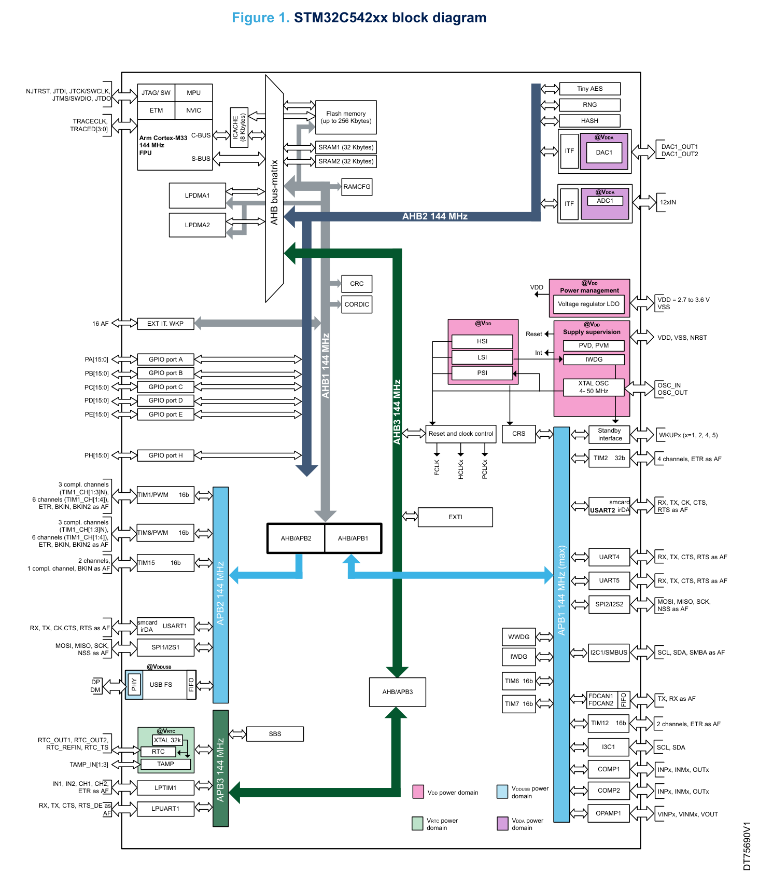
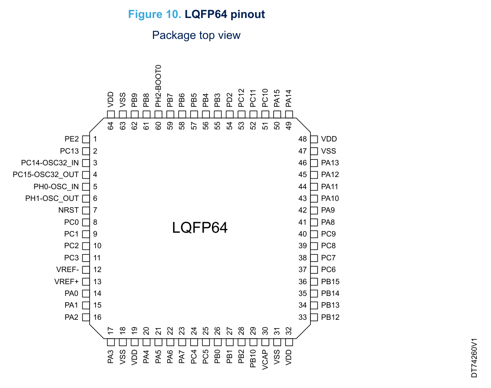

# NUCLEO-C542RC 四实验 Demo

基于 ST **NUCLEO-C542RC** 开发板的 STM32C5 入门示例仓库。四个实验从 GPIO 点灯开始，逐步覆盖串口通信、定时器中断和低功耗唤醒，全部使用 **STM32CubeMX2 + CMake + GNU Tools for STM32** 开发，并已在实机上完成编译、烧录与功能验证。

`STM32C542RCT6` · `Arm Cortex-M33 @ 144 MHz` · `STM32CubeMX2 1.1.2` · `CMake + Ninja` · `GCC 14.3.1` · `VS Code`

> 配套图文教程：[Markdown](docs/STM32C5_NUCLEO-C542RC_4Labs.md) · [PDF](docs/STM32C5_NUCLEO-C542RC_4Labs.pdf)

---

## 目录

- [项目内容](#项目内容)
- [实验总览](#实验总览)
- [硬件平台](#硬件平台)
- [软件环境](#软件环境)
- [仓库结构](#仓库结构)
- [快速开始](#快速开始)
- [实验详解](#实验详解)
  - [实验一：GPIO 输入输出](#实验一gpio-输入输出)
  - [实验二：USART2 串口通信](#实验二usart2-串口通信)
  - [实验三：TIM6 定时器中断](#实验三tim6-定时器中断)
  - [实验四：Sleep 低功耗与 EXTI 唤醒](#实验四sleep-低功耗与-exti-唤醒)
- [常见问题](#常见问题)
- [已验证环境](#已验证环境)
- [参考资料](#参考资料)
- [作者](#作者)

---

## 项目内容

本仓库围绕一块 NUCLEO-C542RC，提供四个由浅入深的最小可运行工程：

1. **GPIO**：用 PA5 驱动板载 LED，PC13 读取按键，完成消抖和闪烁启停控制。
2. **UART**：通过 STLINK-V3EC 提供的虚拟串口收发数据，实现开机信息、字符回显和命令控制。
3. **TIM**：用 TIM6 更新中断产生精确定时，替代 `HAL_Delay()` 实现 LED 周期翻转。
4. **低功耗**：配置 EXTI13 按键唤醒，让 MCU 在空闲时进入 Sleep 模式。

四个实验的代码都尽量保持短小，重点展示 **CubeMX2 工程配置方式**、**HAL2 外设 API** 和 **中断/回调机制**，而不是堆叠功能。

### 学习路径

```text
GPIO 输出/输入
      │
      ├── 轮询 + 软件消抖
      │
      ▼
USART2 串口通信
      │
      ├── 中断接收 + 回调
      │
      ▼
TIM6 定时器中断
      │
      ├── 中断里做最小工作
      │
      ▼
Sleep + EXTI13
      └── 外部中断唤醒低功耗模式
```

---

## 实验总览

| 实验 | 目录 | 使用外设 | 关键配置 | 运行现象 | 主要 API |
|---|---|---|---|---|---|
| 1. GPIO | `Lab1_GPIO_Board` | GPIOA / GPIOC | PA5 推挽输出；PC13 输入；20 ms 消抖 | LD1 每 500 ms 翻转；按 B1 暂停/恢复闪烁 | `HAL_GPIO_ReadPin()`、`HAL_GPIO_WritePin()`、`HAL_GPIO_TogglePin()`、`HAL_GetTick()` |
| 2. UART | `Lab2_UART` | USART2 + GPIOA | 115200 8N1；PA2=TX、PA3=RX；开启 USART2 中断 | 串口打印开机信息；输入字符回显；`1`/`0` 控制 LED，`?` 查看帮助 | `HAL_UART_Receive_IT()`、`HAL_UART_Transmit()`、`HAL_UART_RxCpltCallback()` |
| 3. TIM | `Lab3_TIM` | TIM6 | 内部时钟；PSC=14399、ARR=4999；更新中断 | LD1 每 500 ms 翻转一次，亮灭周期 1 秒 | `HAL_TIM_Start_IT()`、`HAL_TIM_UpdateCallback()` |
| 4. 低功耗 | `Lab4_LowPower` | PWR + EXTI13 + GPIO | PC13 上升沿触发 EXTI13；Sleep 模式 WFI | 快闪 3 次后休眠；按 B1 唤醒并再闪一次 | `HAL_PWR_EnterSleepMode()`、`HAL_EXTI_Enable()`、`HAL_SuspendTick()` |

每个实验目录都包含：

- `*.ioc2`：STM32CubeMX2 工程文件，保存引脚、时钟和外设配置；
- `*_cmake/`：由 CubeMX2 生成的 CMake 工程，可直接编译；
- `*_cmake/build/`：仓库中保留的编译产物，包含 `.elf`、`.map`、`.o` 等，便于对照和快速复现。

---

## 硬件平台

### MCU 主要参数

| 项目 | 参数 |
|---|---|
| MCU 型号 | STM32C542RCT6 |
| 内核 | Arm Cortex-M33 |
| 最高主频 | 144 MHz |
| Flash | 256 KB |
| SRAM | 64 KB |
| 封装 | LQFP64 |
| 调试接口 | SWD |
| 板载调试器 | STLINK-V3EC |
| 供电 | USB Type-C 5 V 输入，板载 3.3 V LDO |

<details>
<summary>STM32C542RC 内部框图</summary>



</details>

STM32C5 与常见的 STM32F1/F4 在工具链上有明显区别：

- 配置工具是 **STM32CubeMX2**，工程文件后缀为 `.ioc2`，经典 STM32CubeMX 无法打开；
- 驱动库是 **HAL2**，部分函数签名、句柄类型和回调机制与 HAL1 不同；
- 默认生成 **CMake** 工程，而不是 Keil MDK 工程；
- 推荐使用 **VS Code + STM32CubeIDE for Visual Studio Code 扩展** 开发。

如果之前只接触过 HAL1，建议先接受一个新习惯：**先查 `generated/hal/` 里的初始化代码，再写应用代码**。CubeMX2 生成的配置和 HAL1 的直觉并不总是一致。

### NUCLEO-C542RC 板载资源

| 功能 | 引脚 / 接口 | 说明 |
|---|---|---|
| 用户 LED LD1 | PA5 | 高电平点亮，低电平熄灭 |
| 用户按键 B1 | PC13 | 按下为高电平；板载 10 kΩ 下拉，空闲为低电平 |
| 虚拟串口 VCP | USART2：PA2=TX，PA3=RX | 115200 8N1，由 STLINK-V3EC 提供 |
| 下载 / 调试 / 供电 | CN1（USB Type-C） | 一根线完成供电、SWD 调试、烧录和虚拟串口 |
| 复位按键 B2 | NRST | 低电平复位 |
| BOOT 按键 B3 | BOOT0 | 正常运行实验时不要按 |
| 电源跳线 JP1 | 默认 `[1-2]` | 由 STLINK-V3EC 的 5 V 供电 |

板上的 LD7、LD6、LD4 分别是 5 V 电源、STLINK 电源和 STLINK 通信指示灯。插上 CN1 后如果这些灯正常、设备管理器能看到虚拟 COM 口，说明板卡和调试器基本正常。

> **安全提示：PC13 不要配置为推挽输出低电平。**
>
> B1 按下时会把 PC13 接到 3V3。如果此时 PC13 被配置为输出低电平，相当于把 3V3 直接短接到地，可能损坏引脚或开发板。PC13 应只作为输入或 EXTI 使用。

<details>
<summary>LQFP64 引脚分布</summary>



</details>

---

## 软件环境

### 版本清单

下表是仓库完成验证时使用的版本，其他兼容版本通常也可以工作：

| 软件 | 验证版本 | 作用 |
|---|---|---|
| STM32CubeMX2 | 1.1.2 | 配置引脚、时钟、外设，生成 `.ioc2` 和 CMake 工程 |
| VS Code | 1.116.0 | 代码编辑、编译、调试 |
| STM32CubeIDE for Visual Studio Code | 3.11.0 | ST 官方扩展包，提供 CMake、ST-LINK、Bundle 管理 |
| GNU Tools for STM32 | 14.3.1 | `arm-none-eabi-gcc`、GDB、binutils |
| CMake / Ninja | 随 Bundle 安装 | 生成构建文件并执行编译 |
| STM32CubeProgrammer | 2.23.0（随 Bundle） | 通过 ST-LINK 烧录 `.elf` |
| ST-LINK 驱动 | Windows 10/11 自动识别 | 提供 SWD 调试和虚拟 COM 口 |

### 安装要点

1. **下载正确的 CubeMX2**：从 ST 官网下载 **STM32CubeMX2**，不要下成经典 STM32CubeMX。安装路径和工程路径都不要包含中文、空格或特殊字符。
2. **首次启动保持联网**：CubeMX2 需要下载 STM32C5 器件包、HAL2 驱动和工程模板。
3. **安装 VS Code 扩展**：在扩展商店搜索并安装 STMicroelectronics 发布的 **STM32CubeIDE for Visual Studio Code**。
4. **安装 System Bundle**：打开 VS Code 左侧 ST 图标，在 **STM32Cube Bundles Manager** 中安装 System Bundle，等待 GCC、CMake、Ninja、GDB、OpenOCD 等工具全部就绪。
5. **把 GCC 加入 PATH**：如果 CMake 报找不到编译器，把类似下面的目录加入用户 PATH，然后重新打开终端和 VS Code：

   ```text
   C:\Users\<用户名>\AppData\Local\stm32cube\bundles\gnu-tools-for-stm32\14.3.1+st.2\bin
   ```

6. **确认虚拟串口**：插入 CN1 后，在设备管理器“端口 (COM 和 LPT)”中应出现 `STMicroelectronics STLink Virtual COM Port (COMx)`。COM 号以本机为准，教程中的 COM14 只是示例。

安装完成后，可以在 PowerShell 中检查：

```powershell
where.exe arm-none-eabi-gcc
arm-none-eabi-gcc --version
cube --version
```

`arm-none-eabi-gcc --version` 能打印 `14.3.1` 即表示工具链可用。

---

## 仓库结构

```text
NUCLEO-C542RC-4Labs/
├── README.md
├── .gitignore
├── docs/
│   ├── STM32C5_NUCLEO-C542RC_4Labs.md    # 详细图文教程
│   ├── STM32C5_NUCLEO-C542RC_4Labs.pdf   # PDF 版本
│   └── images/                           # 框图、引脚图、原理示意图
├── Lab1_GPIO_Board/
│   ├── Lab1_GPIO_Board.ioc2
│   └── Lab1_GPIO_Board_cmake/
├── Lab2_UART/
│   ├── Lab2_UART.ioc2
│   └── Lab2_UART_cmake/
├── Lab3_TIM/
│   ├── Lab3_TIM.ioc2
│   └── Lab3_TIM_cmake/
└── Lab4_LowPower/
    ├── Lab4_LowPower.ioc2
    └── Lab4_LowPower_cmake/
```

以 Lab2 为例，生成的 CMake 工程内部结构如下：

```text
Lab2_UART_cmake/
├── main.c                    # 用户应用代码
├── main.h
├── CMakeLists.txt
├── CMakePresets.json         # 预设：debug_GCC_NUCLEO-C542RC
├── generated/hal/            # CubeMX2 生成的外设初始化代码
│   ├── mx_system.c
│   ├── mx_rcc.c
│   ├── mx_gpio_default.c
│   └── mx_usart2.c
├── stm32c5xx_drivers/        # HAL2 驱动
├── stm32c5xx_dfp/            # 器件支持包
├── cmake/                    # 工具链和构建脚本
├── user_modifiable/          # 可修改的配置文件
└── build/
    └── debug_GCC_NUCLEO-C542RC/
        ├── Lab2_UART.elf
        ├── Lab2_UART.map
        └── ...
```

几个目录的职责需要分清楚：

- **`main.c`**：应用逻辑写在这里；
- **`generated/hal/mx_*.c`**：CubeMX2 根据 `.ioc2` 生成的初始化代码，不要手动修改；
- **`user_modifiable/`**：允许用户修改的配置层；
- **`build/`**：编译产物，可删除后重新生成。

> 仓库保留了 `build/`，是为了让读者能直接查看 `.elf`、`.map` 和编译结果。这些文件可能包含原机器的绝对路径；换电脑后建议清理 `build/` 并重新编译。
>
> 如果需要在 CubeMX2 中重新生成代码，先备份 `main.c`，并确认重新生成不会覆盖自己的应用逻辑。

---

## 快速开始

### 1. 获取代码

```powershell
git clone https://github.com/Yangyuheng1021/NUCLEO-C542RC-4Labs.git
cd NUCLEO-C542RC-4Labs
```

### 2. 用 VS Code 打开

用 VS Code 打开**具体实验的 `*_cmake` 目录**，而不是仓库根目录。例如：

```text
NUCLEO-C542RC-4Labs\Lab2_UART\Lab2_UART_cmake
```

打开层级很重要：资源管理器里应该直接看到 `CMakeLists.txt`、`CMakePresets.json` 和 `main.c`。如果看到的是 `.ioc2` 和 `*_cmake` 文件夹，说明打开的是上一层。

### 3. 让 VS Code 接管 STM32Cube 工程

首次打开某个工程时，如果 CMake 面板没有出现预设，按以下步骤操作：

1. 按 `Ctrl+Shift+P` 打开命令面板；
2. 执行 **`STM32Cube: Set up STM32Cube projects`**（中文界面为“设置 STM32Cube 项目”）；
3. 选择当前工程，工具链选择 **GNU Tools for STM32 / GCC 14.3.1**；
4. 执行 **`CMake: Select Configure Preset`**；
5. 选择 **`debug_GCC_NUCLEO-C542RC`**。

如果工程仍未识别，可以执行 **`STM32Cube: Restore STM32Cube CMake project configuration`** 恢复工程配置。

### 4. 编译与烧录

在 VS Code 中：

| 操作 | 快捷键 | 说明 |
|---|---|---|
| 编译 | `F7` | 等价于 CMake Build，生成 `.elf` |
| 调试 / 烧录 | `F5` | 选择 **STM32Cube: Launch ST-Link GDB Server** |
| 结束调试 | `Shift+F5` | 释放 ST-LINK 探针 |

也可以在命令行完成同样的事情。进入任意 `*_cmake` 目录后执行：

```powershell
# 1. 配置工程，生成 build/debug_GCC_NUCLEO-C542RC
cube cmake --preset debug_GCC_NUCLEO-C542RC

# 2. 编译
cube cmake --build --preset debug_GCC_NUCLEO-C542RC

# 3. 烧录（以 Lab2 为例）
cube programmer -c port=SWD -w .\build\debug_GCC_NUCLEO-C542RC\Lab2_UART.elf -v -rst
```

各实验的固件路径如下：

| 实验 | ELF 文件 |
|---|---|
| Lab1 GPIO | `Lab1_GPIO_Board_cmake/build/debug_GCC_NUCLEO-C542RC/Lab1_GPIO_Board.elf` |
| Lab2 UART | `Lab2_UART_cmake/build/debug_GCC_NUCLEO-C542RC/Lab2_UART.elf` |
| Lab3 TIM | `Lab3_TIM_cmake/build/debug_GCC_NUCLEO-C542RC/Lab3_TIM.elf` |
| Lab4 LowPower | `Lab4_LowPower_cmake/build/debug_GCC_NUCLEO-C542RC/Lab4_LowPower.elf` |

可以一次编译全部四个实验：

```powershell
$labs = "Lab1_GPIO_Board", "Lab2_UART", "Lab3_TIM", "Lab4_LowPower"

foreach ($lab in $labs) {
    Push-Location "$lab/${lab}_cmake"
    cube cmake --preset debug_GCC_NUCLEO-C542RC
    cube cmake --build --preset debug_GCC_NUCLEO-C542RC
    Pop-Location
}
```

> **编译不等于烧录。**
>
> 编译只是生成电脑上的 `.elf` 文件；只有烧录才会把程序写进 MCU 的 Flash。编译成功后板子没有变化，通常是因为没有烧录，或者烧录的不是当前工程的固件。

### 5. 串口监视器（Lab2）

Lab2 通过 STLINK-V3EC 的虚拟串口通信。打开 VS Code 的串口监视器（或 PuTTY、SecureCRT 等工具）后使用以下参数：

| 参数 | 值 |
|---|---|
| 端口 | STLink Virtual COM Port（以设备管理器为准） |
| 波特率 | 115200 |
| 数据位 | 8 |
| 校验位 | None |
| 停止位 | 1 |
| 流控 | None |

打开串口后按一下 B2 复位，即可看到开机信息：

```text
NUCLEO-C542RC UART Lab
USART2: PA2=TX, PA3=RX, 115200 8N1
Send 1: LED ON, 0: LED OFF, ?: help
```

直接发送单个字符，不需要按回车：

| 输入 | 现象 |
|---|---|
| `1` | LD1 点亮，串口返回 `LED ON` |
| `0` | LD1 熄灭，串口返回 `LED OFF` |
| `?` | 返回命令帮助 |
| 其他可打印字符 | 原样回显 |

---

## 实验详解

### 实验一：GPIO 输入输出

**目录**：[`Lab1_GPIO_Board`](Lab1_GPIO_Board)

#### 实验目标

- 学会把 GPIO 配置为推挽输出，驱动板载 LED；
- 学会把 GPIO 配置为输入，读取板载按键；
- 理解软件消抖和上升沿检测；
- 用 `HAL_GetTick()` 实现非阻塞的周期任务。

#### CubeMX2 配置

| 项目 | 配置 |
|---|---|
| 工程类型 | Board 工程，选择 NUCLEO-C542RC |
| PA5 | GPIO_Output，推挽，无上拉/下拉，标签 `LD1` |
| PC13 | GPIO_Input，无上拉/下拉，标签 `B1` |
| 时钟 | 系统时钟 144 MHz |

PC13 使用输入模式，不额外开启 EXTI。按键检测在 `main()` 的主循环中轮询完成。板载 B1 已经有 10 kΩ 下拉电阻，因此这里不需要再启用内部下拉。

#### 关键代码

```c
#define BLINK_PERIOD_MS 500u
#define DEBOUNCE_MS     20u

uint8_t blink_enabled = 1;
uint8_t button_was_pressed = 0;
uint32_t last_blink_tick = HAL_GetTick();

while (1)
{
    uint8_t button_pressed = (HAL_GPIO_ReadPin(B1_PORT, B1_PIN) == HAL_GPIO_PIN_SET);

    /* 只在“从未按下变为按下”时处理，避免按住时反复触发 */
    if (button_pressed && !button_was_pressed)
    {
        HAL_Delay(DEBOUNCE_MS);

        /* 20 ms 后再读一次，仍为高电平才认为按键有效 */
        if (HAL_GPIO_ReadPin(B1_PORT, B1_PIN) == HAL_GPIO_PIN_SET)
        {
            blink_enabled = !blink_enabled;

            if (blink_enabled)
            {
                HAL_GPIO_WritePin(LD1_PORT, LD1_PIN, HAL_GPIO_PIN_SET);
            }
            else
            {
                HAL_GPIO_WritePin(LD1_PORT, LD1_PIN, HAL_GPIO_PIN_RESET);
            }

            last_blink_tick = HAL_GetTick();
        }
    }

    button_was_pressed = button_pressed;

    /* 用时间戳判断，而不是 HAL_Delay(500)，主循环不会被长时间阻塞 */
    if (blink_enabled && ((HAL_GetTick() - last_blink_tick) >= BLINK_PERIOD_MS))
    {
        HAL_GPIO_TogglePin(LD1_PORT, LD1_PIN);
        last_blink_tick += BLINK_PERIOD_MS;
    }
}
```

#### 实现说明

1. **上升沿检测**：`button_was_pressed` 保存上一次的按键状态，只有“本次按下且上次未按下”才进入处理，避免长按期间反复切换。
2. **软件消抖**：检测到按下后等待 20 ms，再读一次 PC13；仍然为高才承认这次按键。机械按键的抖动通常在几毫秒内结束，20 ms 是常用值。
3. **非阻塞闪烁**：用 `last_blink_tick` 记录上次翻转时间，每次循环比较 `HAL_GetTick()`，到期才翻转。这样按键响应不会被 `HAL_Delay(500)` 卡住。
4. **时间戳重同步**：如果主循环偶尔被其他操作延迟，代码会重新对齐时间戳，避免补偿式连续翻转。
5. **引脚宏**：`LD1_PORT`、`LD1_PIN`、`B1_PORT`、`B1_PIN` 来自 `mx_gpio_default.h`，由 CubeMX2 根据标签生成。应用代码不直接硬编码 `GPIOA`/`GPIO_PIN_5`，可读性更好。

#### 运行现象

- 上电后 LD1 每 500 ms 翻转一次，即亮 500 ms、灭 500 ms，完整周期 1 秒；
- 按一下 B1，LED 停止闪烁并保持当前状态；
- 再按一下 B1，LED 恢复闪烁。

#### 注意事项

- PC13 只作为输入使用，绝不能配置为推挽输出低电平；
- 如果按键反应过于灵敏或偶尔连跳，可以适当增大 `DEBOUNCE_MS`；
- 如果 LED 逻辑相反，先检查板载 LD1 的驱动极性，再调整 `HAL_GPIO_WritePin()` 的参数。

---

### 实验二：USART2 串口通信

**目录**：[`Lab2_UART`](Lab2_UART)

#### 实验目标

- 配置 USART2 使用 STLINK-V3EC 的虚拟串口；
- 掌握 HAL2 的中断接收和回调函数；
- 实现开机信息打印、字符回显和简单命令解析；
- 理解“中断接收一个字节后必须重新挂接收”的机制。

#### CubeMX2 配置

| 项目 | 配置 |
|---|---|
| USART2 | Asynchronous，115200 baud |
| 数据格式 | 8 数据位，无校验，1 停止位 |
| 引脚 | PA2 = USART2_TX，PA3 = USART2_RX |
| USART2 时钟源 | PCLK1 |
| NVIC | 使能 USART2 global interrupt |
| 工程类型 | Board 工程，选择 NUCLEO-C542RC |

#### 关键代码

```c
static hal_uart_handle_t *g_uart;
static uint8_t g_rx_byte;

static void uart_send(const char *text)
{
    HAL_UART_Transmit(g_uart, text, (uint32_t)strlen(text), 1000u);
}

void HAL_UART_RxCpltCallback(hal_uart_handle_t *huart,
                             uint32_t size_byte,
                             hal_uart_rx_event_types_t rx_event)
{
    uint8_t ch = g_rx_byte;
    (void)size_byte;
    (void)rx_event;

    if (ch == '1')
    {
        HAL_GPIO_WritePin(LD1_PORT, LD1_PIN, HAL_GPIO_PIN_SET);
        uart_send("\r\nLED ON\r\n");
    }
    else if (ch == '0')
    {
        HAL_GPIO_WritePin(LD1_PORT, LD1_PIN, HAL_GPIO_PIN_RESET);
        uart_send("\r\nLED OFF\r\n");
    }
    else if (ch == '?')
    {
        uart_send("\r\n1=LED ON, 0=LED OFF, ?=help\r\n");
    }
    else if ((ch >= 32u) && (ch <= 126u))
    {
        HAL_UART_Transmit(huart, &ch, 1u, 100u);
    }

    /* 关键：回调结束后重新挂上接收，否则下一次中断不会到来 */
    HAL_UART_Receive_IT(huart, &g_rx_byte, 1u);
}
```

主函数中先获取句柄，再启动第一次中断接收并打印欢迎信息：

```c
g_uart = mx_usart2_uart_gethandle();
if (g_uart == NULL)
{
    return (-1);
}

HAL_UART_Receive_IT(g_uart, &g_rx_byte, 1u);

uart_send("\r\nNUCLEO-C542RC UART Lab\r\n");
uart_send("USART2: PA2=TX, PA3=RX, 115200 8N1\r\n");
uart_send("Send 1: LED ON, 0: LED OFF, ?: help\r\n");
```

#### 实现说明

1. **句柄获取**：HAL2 不直接暴露全局句柄，需要通过 `mx_usart2_uart_gethandle()` 获取 `hal_uart_handle_t *`。
2. **单字节中断接收**：`HAL_UART_Receive_IT(g_uart, &g_rx_byte, 1u)` 每次只接收 1 个字节，收到后触发 `HAL_UART_RxCpltCallback()`。
3. **重新挂接收**：回调最后再次调用 `HAL_UART_Receive_IT()`。这是新手最容易漏掉的一步；不重新挂接收，串口只能收到第一个字符。
4. **命令解析**：`1`、`0` 分别控制 LED，`?` 打印帮助，其余可打印 ASCII 字符原样回显。不可打印字符（例如回车、换行）被忽略。
5. **弱回调覆盖**：这里直接定义 `HAL_UART_RxCpltCallback()`，覆盖 HAL 中的弱符号实现。没有使用 `HAL_UART_RegisterRxCpltCallback()`，因为该注册接口受 `USE_HAL_UART_REGISTER_CALLBACKS` 宏控制，默认可能是关闭的。
6. **演示代码的简化**：`uart_send()` 在回调中间接调用了阻塞式 `HAL_UART_Transmit()`。在 115200 波特率下发送短字符串可以正常工作，但严格来说不应在中断里做长时间阻塞。实际项目建议改用发送缓冲区 + DMA，或把应答拼好后交给主循环发送。

#### 运行现象

- 打开串口监视器并复位板卡后，打印三行开机信息；
- 发送 `1`，LD1 点亮，串口返回 `LED ON`；
- 发送 `0`，LD1 熄灭，串口返回 `LED OFF`；
- 发送 `?`，打印命令帮助；
- 发送其他可见字符（如 `A`），串口回显同一个字符。

#### 注意事项

- 串口工具必须选择 STLINK 对应的 COM 口，而不是其他虚拟串口；
- 必须设置为 115200 8N1、无流控；
- 如果只打印开机信息但无法控制 LED，优先检查 `HAL_UART_Receive_IT()` 是否成功启动、回调是否重新挂接收；
- 如果发送中文或不可打印字符没有反应，这是代码只回显 ASCII 32～126 的设计，不是串口故障。

---

### 实验三：TIM6 定时器中断

**目录**：[`Lab3_TIM`](Lab3_TIM)

#### 实验目标

- 配置 TIM6 产生 500 ms 更新中断；
- 学会在中断回调中完成最小工作；
- 用定时器替代 `HAL_Delay()`，理解“主循环空闲、定时由硬件保证”的结构；
- 掌握定时器频率的计算方法。

#### CubeMX2 配置

| 项目 | 配置 |
|---|---|
| TIM6 | 内部时钟，更新事件 |
| 更新中断 | 使能 |
| NVIC | 使能 TIM6 global interrupt |
| 初始 PSC / ARR | CubeMX2 生成默认值 PSC=0、ARR=0xFFFF |
| 工程类型 | Board 工程，选择 NUCLEO-C542RC |

CubeMX2 生成的 `mx_tim6.c` 中默认：

```c
config.prescaler = 0;
config.period    = 0xFFFF;
```

这两个值不会产生 500 ms 中断，所以应用代码在启动前显式覆盖。

#### 定时参数计算

当前系统时钟为 144 MHz，TIM6 使用内部时钟：

| 参数 | 计算 | 结果 |
|---|---|---|
| 定时器输入时钟 | 144 MHz | 144 000 000 Hz |
| PSC | 14399 | 144 MHz ÷ (14399 + 1) = 10 kHz |
| ARR | 4999 | 10 kHz ÷ (4999 + 1) = 2 Hz |
| 更新周期 | 1 ÷ 2 Hz | 500 ms |
| LED 翻转周期 | 500 ms 翻转一次 | 亮灭完整周期 1 s |

通用公式：

```text
更新频率 = 定时器时钟 / ((PSC + 1) × (ARR + 1))
```

#### 关键代码

```c
void HAL_TIM_UpdateCallback(hal_tim_handle_t *htim)
{
    (void)htim;

    /* 每次 TIM6 更新事件翻转一次 LD1 */
    HAL_GPIO_TogglePin(LD1_PORT, LD1_PIN);
}

int main(void)
{
    if (mx_system_init() != SYSTEM_OK)
    {
        return (-1);
    }

    hal_tim_handle_t *htim6 = mx_tim6_gethandle();
    if (htim6 == NULL)
    {
        return (-1);
    }

    /* 144 MHz / (14399 + 1) = 10 kHz，再计 5000 个数 = 500 ms */
    HAL_TIM_SetPrescaler(htim6, 14399u);
    HAL_TIM_SetPeriod(htim6, 4999u);

    if (HAL_TIM_Start_IT(htim6) != HAL_OK)
    {
        return (-1);
    }

    while (1)
    {
        HAL_Delay(100u);
    }
}
```

#### 实现说明

1. **覆盖默认参数**：`HAL_TIM_SetPrescaler()` 和 `HAL_TIM_SetPeriod()` 必须在 `HAL_TIM_Start_IT()` 之前调用。
2. **更新中断回调**：TIM6 每次计数溢出产生更新事件，HAL 调用 `HAL_TIM_UpdateCallback()`。回调只做一次 GPIO 翻转，执行时间极短。
3. **主循环为空**：LED 的节奏完全由硬件定时器决定，主循环中的 `HAL_Delay(100u)` 不参与定时，只用于降低空转功耗。
4. **不改 generated 代码**：没有去修改 `mx_tim6.c` 中的默认 PSC/ARR，而是在用户代码中覆盖，重新生成时不会丢失这段逻辑。
5. **HAL2 回调签名**：`HAL_TIM_UpdateCallback(hal_tim_handle_t *htim)` 与 HAL1 的 `HAL_TIM_PeriodElapsedCallback(TIM_HandleTypeDef *htim)` 不同，注意不要照抄 F1/F4 的代码。

#### 运行现象

- LD1 每 500 ms 翻转一次；
- 用示波器或逻辑分析仪观察 PA5，可看到 1 Hz 方波，占空比约 50%；
- 修改 PSC 或 ARR 后，闪烁速度按公式变化。

#### 注意事项

- 如果系统时钟被修改，PSC/ARR 需要重新计算；
- 如果中断没有进入，检查 `TIM6_IRQHandler()` 是否存在、NVIC 是否使能、`HAL_TIM_Start_IT()` 是否返回 `HAL_OK`；
- 中断回调中不要加入 `HAL_Delay()`、长循环或阻塞式打印。

---

### 实验四：Sleep 低功耗与 EXTI 唤醒

**目录**：[`Lab4_LowPower`](Lab4_LowPower)

#### 实验目标

- 配置 PC13 为 EXTI13 上升沿触发；
- 让 MCU 在空闲时进入 Sleep 模式；
- 用按键中断把 MCU 从 Sleep 中唤醒；
- 理解 `HAL_SuspendTick()`、`HAL_ResumeTick()` 与 WFI 的配合。

#### CubeMX2 配置

| 项目 | 配置 |
|---|---|
| PA5 | GPIO_Output，推挽，标签 `LD1` |
| PC13 | GPIO_EXTI13，上升沿触发，标签 `B1` |
| EXTI13 | 使能中断 |
| NVIC | 使能 EXTI13 global interrupt |
| 低功耗模式 | Sleep（WFI） |
| 工程类型 | Board 工程，选择 NUCLEO-C542RC |

生成的 `mx_gpio_default.c` 中可以看到 EXTI13 的实际配置：

```c
exti_config.trigger   = HAL_EXTI_TRIGGER_RISING;
exti_config.gpio_port = HAL_EXTI_GPIOC;
HAL_EXTI_SetConfig(&hEXTI13, &exti_config);
```

#### 关键代码

```c
static void led_blink(uint32_t times)
{
    for (uint32_t i = 0u; i < times; i++)
    {
        HAL_GPIO_WritePin(LD1_PORT, LD1_PIN, HAL_GPIO_PIN_SET);
        HAL_Delay(100u);
        HAL_GPIO_WritePin(LD1_PORT, LD1_PIN, HAL_GPIO_PIN_RESET);
        HAL_Delay(100u);
    }
}

/* 唤醒动作本身已经足够，这个回调不需要做额外处理 */
void HAL_EXTI_TriggerCallback(hal_exti_handle_t *hexti, hal_exti_trigger_t trigger)
{
    (void)hexti;
    (void)trigger;
}

int main(void)
{
    if (mx_system_init() != SYSTEM_OK)
    {
        return (-1);
    }

    hal_exti_handle_t *hexti = mx_gpio_default_exti13_gethandle();
    if (hexti == NULL)
    {
        return (-1);
    }

    HAL_EXTI_Enable(hexti, HAL_EXTI_MODE_INTERRUPT);

    while (1)
    {
        /* 醒着的时候快闪 3 次：约 600 ms */
        led_blink(3u);

        HAL_GPIO_WritePin(LD1_PORT, LD1_PIN, HAL_GPIO_PIN_RESET);

        /* 进入 Sleep 前清除挂起标志，避免立刻又被唤醒 */
        HAL_EXTI_ClearPending(hexti, HAL_EXTI_TRIGGER_RISING);

        /* 关闭 SysTick，避免系统节拍中断把 Sleep 唤醒 */
        HAL_SuspendTick();
        HAL_PWR_EnterSleepMode(HAL_PWR_LOW_PWR_MODE_WFI);
        HAL_ResumeTick();

        /* 按键唤醒后，LED 亮 500 ms 作为反馈 */
        HAL_GPIO_WritePin(LD1_PORT, LD1_PIN, HAL_GPIO_PIN_SET);
        HAL_Delay(500u);
        HAL_GPIO_WritePin(LD1_PORT, LD1_PIN, HAL_GPIO_PIN_RESET);
        HAL_Delay(200u);
    }
}
```

#### 实现说明

1. **EXTI13 上升沿**：B1 按下时 PC13 由低变高，正好产生上升沿；松开时不会触发。
2. **为什么用 EXTI**：Sleep 模式下 CPU 时钟停止，普通轮询代码不再执行，只有中断能够把内核唤醒。
3. **清挂起标志**：在进入 Sleep 前调用 `HAL_EXTI_ClearPending()`，防止之前残留的 EXTI 标志导致“刚睡下就醒”。
4. **关闭 SysTick**：SysTick 默认周期性产生中断，任何中断都能唤醒 Sleep。调用 `HAL_SuspendTick()` 后，系统节拍不会干扰休眠；唤醒后再 `HAL_ResumeTick()` 恢复。
5. **WFI 指令**：`HAL_PWR_EnterSleepMode(HAL_PWR_LOW_PWR_MODE_WFI)` 执行 Wait For Interrupt，CPU 停在当前指令等待中断。EXTI13 中断到来后，程序从下一条语句继续执行。
6. **空回调是故意的**：唤醒由 EXTI 硬件完成，回调里不需要写逻辑。如果以后要统计唤醒次数，可以在这里对一个 `volatile` 变量自增。
7. **唤醒后的反馈**：LED 亮 500 ms、灭 200 ms，然后重新快闪 3 次并再次休眠，方便观察“唤醒—运行—休眠”的循环。

#### 运行现象

- 上电后 LD1 快闪 3 次（每次亮 100 ms、灭 100 ms，约 600 ms）；
- 随后 LED 熄灭，MCU 进入 Sleep；
- 按一下 B1，LED 点亮 500 ms，然后熄灭 200 ms；
- 接着再次快闪 3 次，重新进入 Sleep；
- 每次按键都会重复上述过程。

#### 注意事项

- 如果按键一次触发多次唤醒，检查是否配置成了双边沿触发，以及是否在进入 Sleep 前清除了挂起标志；
- 如果程序无法进入 Sleep，检查 SysTick 是否已暂停、是否有其他周期性中断在运行；
- 调试器连接时也可以观察唤醒流程，但调试器本身会影响低功耗行为；本实验只验证唤醒功能，不测量具体休眠电流；
- 若需要评估实际电流，应参考 NUCLEO-C542RC 用户手册中的电流测量方法，并在脱离调试器的条件下测试。

---

## 常见问题

### 1. CMake 报 `arm-none-eabi-gcc not found`

**现象**

```text
The CMAKE_C_COMPILER: arm-none-eabi-gcc is not a full path and was not found in the PATH.
```

**原因**：GCC Bundle 的 `bin` 目录不在 PATH 中。CMake 的工具链文件按 PATH 查找编译器。

**解决**：把下面的目录加入用户 PATH，然后重新打开终端和 VS Code：

```text
C:\Users\<用户名>\AppData\Local\stm32cube\bundles\gnu-tools-for-stm32\14.3.1+st.2\bin
```

验证：

```powershell
where.exe arm-none-eabi-gcc
arm-none-eabi-gcc --version
```

### 2. `cube programmer` 报 `DEV_CONNECT_ERR`

**原因**：ST-LINK 探针同一时间只能被一个程序占用。VS Code 调试时启动的 `ST-LINK_gdbserver.exe` 或 `stlinkserver.exe` 可能仍在后台占用探针。

**解决**：

1. 在 VS Code 中按 `Shift+F5` 结束调试；
2. 如果仍然报错，在任务管理器中结束 `ST-LINK_gdbserver.exe` 和 `stlinkserver.exe`；
3. 或执行：

   ```powershell
   taskkill /F /IM ST-LINK_gdbserver.exe
   taskkill /F /IM stlinkserver.exe
   ```

4. 重新执行烧录命令。

### 3. CubeMX2 的 GPIO 配置页一直显示 `Loading the form...`

这是 STM32CubeMX2 1.1.2 在部分 MCU 工程中的已知问题，日志可能提示 NVIC 模型版本迁移失败。

**解决**：改用 **Board 工程**，直接选择 NUCLEO-C542RC。本仓库四个实验都使用 Board 工程，可以正常配置和生成代码。如果仍然卡住，关闭 CubeMX2 后重新启动，并确认器件包已经完整下载。

### 4. 串口没有输出或输出乱码

按顺序检查：

- COM 口是否选成了 STLink Virtual COM Port；
- 波特率是否为 115200，数据位 8、无校验、停止位 1、无流控；
- 是否有其他串口工具占用了同一个 COM 口；
- 打开串口后按 B2 复位，确认能重新打印开机信息；
- 如果只能打印、不能接收，检查 `HAL_UART_Receive_IT()` 是否启动，以及回调末尾是否重新挂接收；
- 如果使用 USB 延长线或集线器，尝试直接连接电脑 USB 口。

### 5. 编译成功，但板子没有变化

编译只生成 `.elf`，不会自动烧录。请确认：

- 已经执行 `cube programmer` 烧录，或在 VS Code 中通过 `F5` 烧录；
- 烧录路径指向当前实验的 `build/debug_GCC_NUCLEO-C542RC/*.elf`；
- 烧录完成后按一下 B2 复位；
- 没有把旧工程的 `.elf` 烧进板子。

### 6. 直接调用注册回调函数时报 `implicit declaration`

HAL2 的回调注册接口（如 `HAL_UART_RegisterRxCpltCallback()`、`HAL_TIM_RegisterUpdateCallback()`）受 `USE_HAL_XXX_REGISTER_CALLBACKS` 宏控制，不同外设的默认值可能不同。

**推荐做法**：像本仓库一样直接定义弱回调函数：

- `HAL_UART_RxCpltCallback()`
- `HAL_TIM_UpdateCallback()`
- `HAL_EXTI_TriggerCallback()`

如果确实要用注册接口，先打开 `generated/hal/stm32c5xx_hal_conf.h`，把对应宏改为 `1U`，再使用注册函数。

### 7. `.ioc2` 文件打不开

`.ioc2` 是 **STM32CubeMX2** 的工程格式；经典 STM32CubeMX 只能打开 `.ioc`。C5 系列必须使用 CubeMX2，不要把 `.ioc` 和 `.ioc2` 混用，也不要把 HAL1 的初始化代码直接复制到 HAL2 工程。

### 8. 构建提示 `ninja: no work to do`

这不是错误，表示源代码没有变化，Ninja 认为不需要重新编译。修改代码后会自动重新构建；如果怀疑构建缓存异常，可以清理 `build/` 后重新配置。

### 9. 换电脑后 CMake 报路径错误

仓库中的 `build/` 和部分工程元数据可能包含原机器的绝对路径。换电脑后建议：

1. 将 `build/` 目录改名或删除；
2. 重新执行 `cube cmake --preset debug_GCC_NUCLEO-C542RC`；
3. 再执行 `cube cmake --build --preset debug_GCC_NUCLEO-C542RC`。

### 10. 烧录后 LED 不闪或按键无反应

先确认烧录的是对应实验的固件，再做最小化排查：

- Lab1：确认 PA5 配置为输出，PC13 配置为输入；
- Lab2：确认 USART2 中断已使能，串口参数正确；
- Lab3：确认 TIM6 的 PSC/ARR 在 `HAL_TIM_Start_IT()` 之前设置；
- Lab4：确认 EXTI13 为上升沿触发，且进入 Sleep 前已清挂起标志。

---

## 已验证环境

以下结果是本仓库完成时的实测记录：

| 项目 | 内容 |
|---|---|
| 开发板 | NUCLEO-C542RC（STM32C542RCT6） |
| 调试器 | 板载 STLINK-V3EC |
| 配置工具 | STM32CubeMX2 1.1.2 |
| IDE | VS Code + STM32CubeIDE for VS Code 3.11.0 |
| 工具链 | GNU Tools for STM32 14.3.1 |
| 构建系统 | CMake + Ninja |
| 操作系统 | Windows 11 |
| 验证日期 | 2026-10-25 |

| 实验 | 编译 | 烧录 | 功能验证 |
|---|---|---|---|
| Lab1 GPIO | 通过 | 通过 | LED 闪烁、按键启停正常 |
| Lab2 UART | 通过 | 通过 | 开机信息、回显、命令控制正常 |
| Lab3 TIM | 通过 | 通过 | TIM6 中断每 500 ms 翻转 LED |
| Lab4 LowPower | 通过 | 通过 | Sleep 休眠、EXTI13 按键唤醒正常 |

---

## 参考资料

- [详细图文教程（Markdown）](docs/STM32C5_NUCLEO-C542RC_4Labs.md)
- [详细图文教程（PDF）](docs/STM32C5_NUCLEO-C542RC_4Labs.pdf)
- [STM32C542RC 内部框图](docs/images/stm32c542rc_block_diagram.png)
- [LQFP64 引脚分布](docs/images/lqfp64_pinout.png)
- [GPIO 内部结构](docs/images/gpio_structure.png)
- [GPIO 输入配置](docs/images/gpio_input_config.png)
- [GPIO 输出配置](docs/images/gpio_output_config.png)
- [USART 内部框图](docs/images/usart_block_diagram.png)
- [TIM6 内部框图](docs/images/tim6_block_diagram.png)
- [EXTI 内部框图](docs/images/exti_block_diagram.png)
- [低功耗模式对比](docs/images/low_power_modes.png)
- [时钟树](docs/images/clock_tree.png)
- [Cortex-M33 实现](docs/images/cortex_m33_implementation.png)

ST 官方资料建议以 UM3615（STM32C5 HAL 驱动用户手册）、STM32C542 数据手册和 NUCLEO-C542RC 用户手册为准。

---

## 作者

Yangyuheng1021

仓库地址：<https://github.com/Yangyuheng1021/NUCLEO-C542RC-4Labs>
