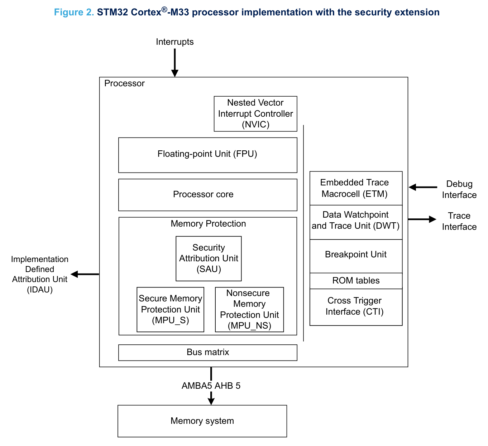
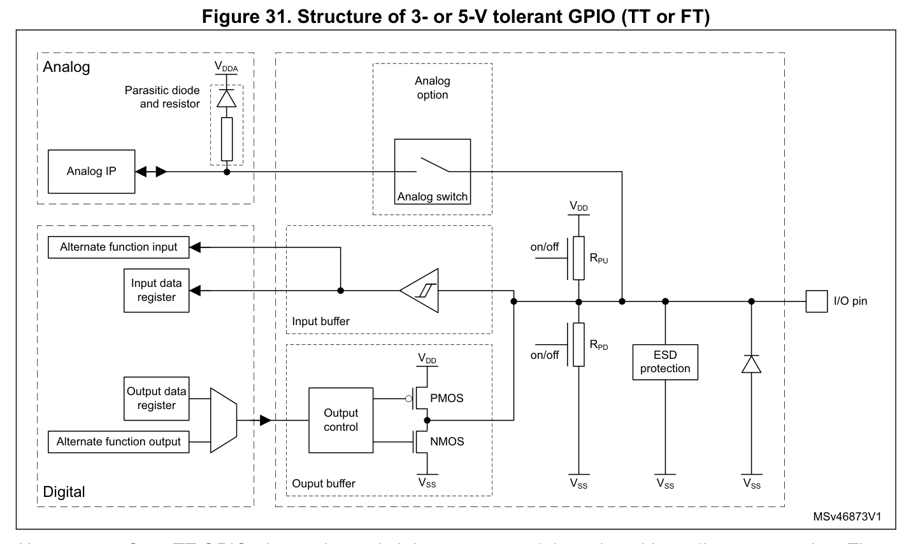
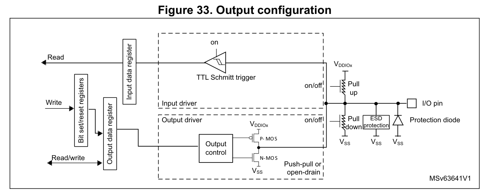
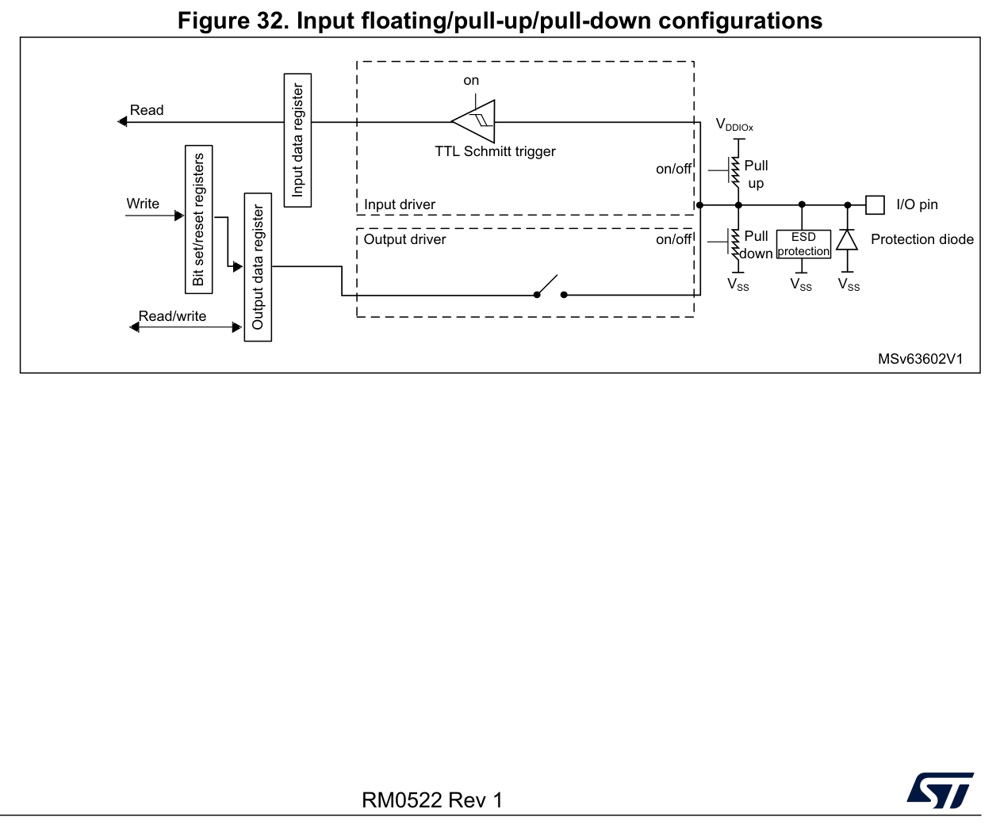
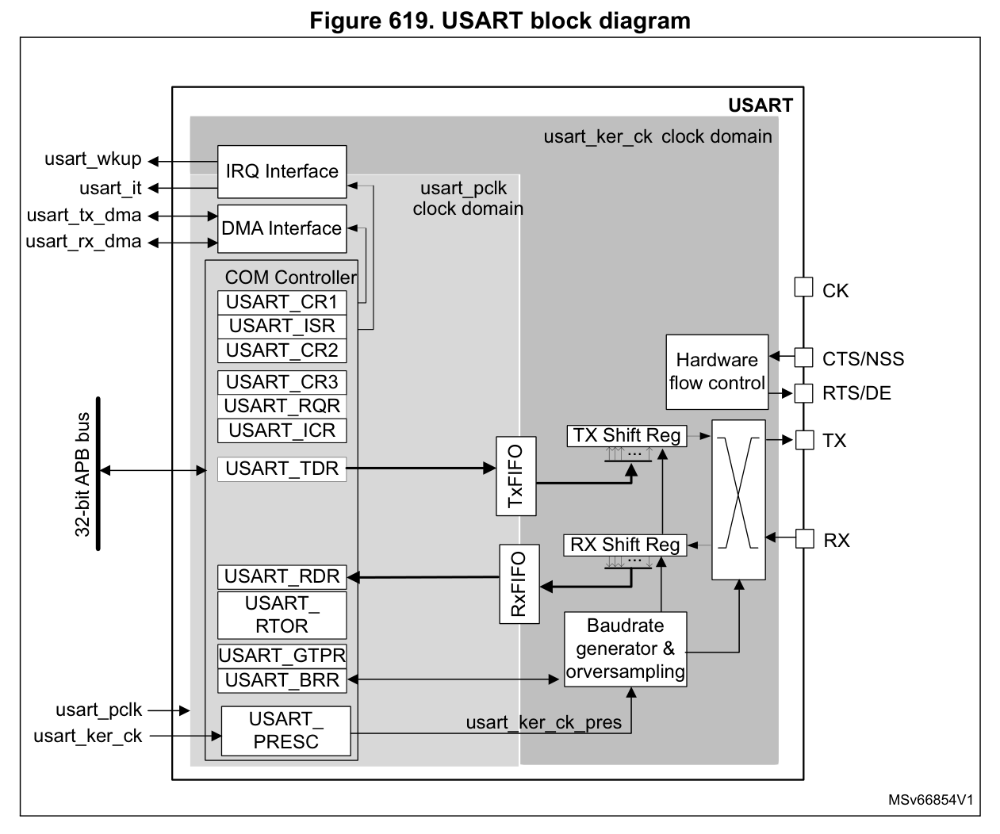
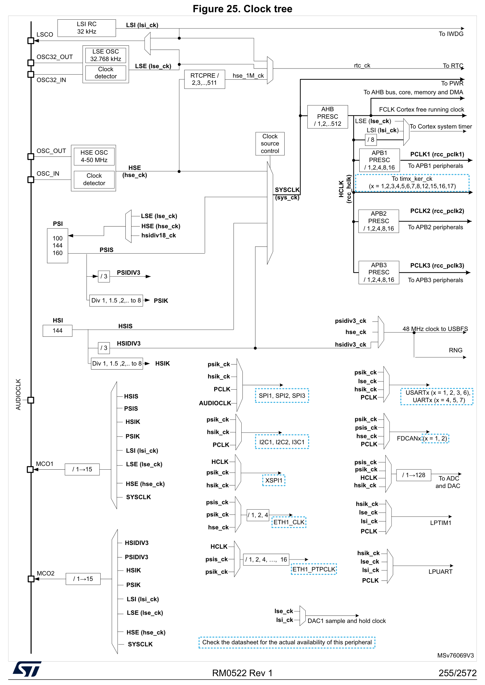
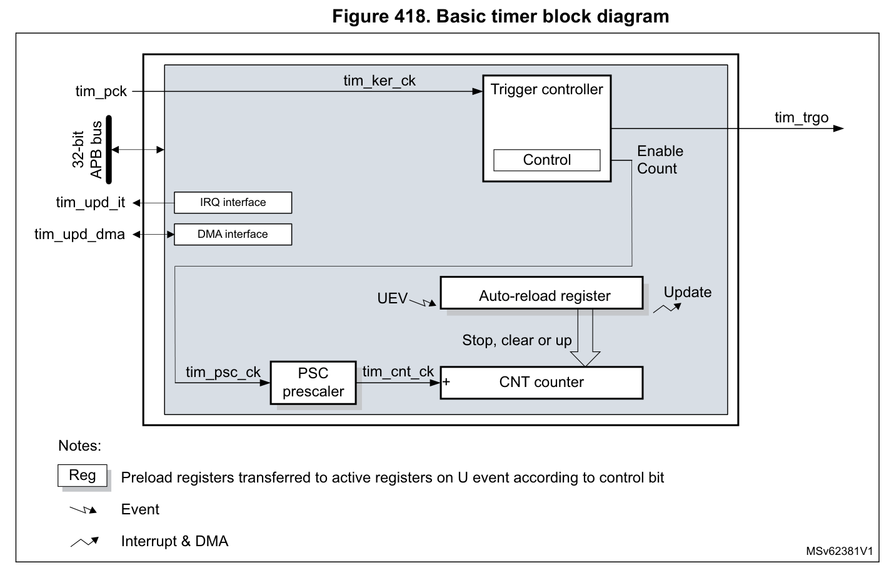
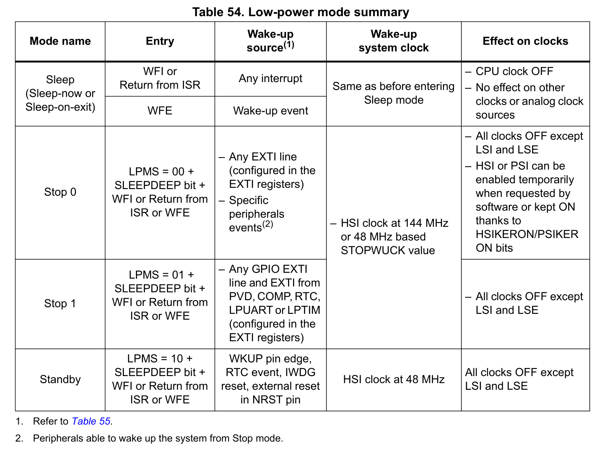
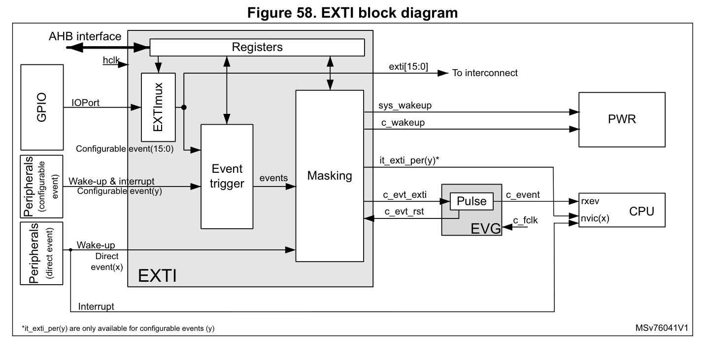

# STM32C5 入门实战：基于 NUCLEO-C542RC 的 GPIO、串口、定时器与低功耗四实验全记录

> 关键词：STM32C5、NUCLEO-C542RC、STM32C542RCT6、CubeMX2、HAL2、CMake、嵌入式入门
>
> 完整工程仓库：[https://github.com/Yangyuheng1021/NUCLEO-C542RC-4Labs](https://github.com/Yangyuheng1021/NUCLEO-C542RC-4Labs)

如果你刚拿到 ST 的 NUCLEO-C542RC，或者想看看 STM32C5 这个新系列到底怎么上手，这篇文章会从环境搭建开始，带你完成四个最基础的实验：GPIO 输入输出、USART2 串口通信、TIM6 定时器中断、Sleep 低功耗与按键唤醒。

本文的代码在 NUCLEO-C542RC（STM32C542RCT6）上实际编译、烧录、运行过，仓库里保留了四个独立的 CubeMX2 工程、完整源码和编译产物。你可以按顺序阅读，也可以直接跳到关心的实验。

STM32C5 是 ST 面向主流市场推出的 Arm Cortex-M33 系列，主频 144 MHz，带 TrustZone 安全能力。它和 F1/F4 最大的不同不只是芯片本身，而是整套软件栈：C5 使用 **HAL2** 驱动库，配置工具必须用 **STM32CubeMX2**（不是经典 STM32CubeMX），工程文件是 `.ioc2`，默认生成 **CMake + Ninja + GCC** 工程。网上大量 F1/F4 的 HAL1 代码不能直接照抄，工具链也不再是“CubeMX 生成 Keil/IAR 工程”那一套。

这篇文章会同时照顾两类读者：

- 刚接触 NUCLEO 和 CubeMX2 的新手：环境安装、引脚配置、编译、烧录、串口验证都按步骤写清楚；
- 从 F1/F4/L 系列过来的老手：重点标注 HAL2 与 HAL1 的差异、CubeMX2 与经典 CubeMX 的差异，以及 C5 新工具链里容易踩的坑。

为了不让术语打断阅读，先给几个高频词一句话解释：HAL2 是 ST 第二代硬件抽象层库，封装寄存器操作；CMake 是跨平台构建工具，根据 `CMakeLists.txt` 生成 Ninja/Make 构建文件；VCP 是 ST-LINK 虚拟出来的串口；NVIC 是 Cortex-M 的中断控制器，负责中断使能和优先级；EXTI 是外部中断控制器，把 GPIO 边沿变成中断；PSC/ARR 是定时器的预分频和自动重装载值；WFI 是“等待中断”指令，CPU 执行后进入低功耗；PSI 是 C5 的时钟倍频单元，把 24 MHz HSE 倍到 144 MHz；TrustZone 是 Arm 的硬件安全隔离技术。

## 1. 芯片与开发板：STM32C5 是什么水平？

### 1.1 核心参数

| 项目 | 参数 |
|---|---|
| MCU 型号 | STM32C542RCT6 |
| 内核 | Arm Cortex-M33 |
| 主频 | 144 MHz |
| Flash | 256 KB |
| SRAM | 64 KB |
| 封装 | LQFP64 |
| 调试接口 | SWD |
| 板载调试器 | STLINK-V3EC |
| 供电 | 3.3 V 典型（板载 3.3 V LDO，USB-C 5 V 输入） |
| 常见外设 | USART/LPUART、TIM、GPIO、ADC、DAC、USB、FDCAN、AES/HASH/PKA、TrustZone 等（具体以型号和封装为准） |
| 开发工具 | STM32CubeMX2 1.1.2 + CMake + GNU Tools for STM32 14.3.1 |

整颗芯片的全貌可以直接看官方系统框图：Cortex-M33 内核居中，通过总线矩阵挂 SRAM、Flash 和各类外设，本文用到的 GPIO、USART2、TIM6、EXTI、NVIC/PWR 都在里面，对照着看后文各实验会更直观。


Cortex-M33 可以理解为 Cortex-M3/M4 的新一代继任者：它保留了适合单片机的中断和低功耗特性，同时加入了 TrustZone 安全隔离、DSP 指令和更高的能效。对大多数入门实验来说，你暂时用不到 TrustZone，但它决定了 C5 的启动、时钟和安全配置比 F1/F4 多一层概念。

Cortex-M33 内核的实现框图如下，NVIC（中断控制器）、FPU、MPU、TrustZone 的 SAU/IDAU 一目了然：



从工具链角度看，C5 的关键词是“新”：

- 配置工具是 **STM32CubeMX2**，工程后缀 `.ioc2`，经典 CubeMX 打不开；
- 驱动库是 **HAL2**，类型名、回调机制和 HAL1 不完全兼容；
- 默认工程格式是 **CMake**，不再直接生成 Keil MDK5 工程；
- ST 推荐的 IDE 是 **STM32CubeIDE**，或者 **VS Code + STM32CubeIDE for VS Code 扩展**。

如果你是从 F1/F4 过来的老手，建议先把“HAL1 的代码直觉”放一放：C5 的很多 API 名字看起来一样，但参数和句柄类型已经变了，后面会具体讲。

### 1.2 NUCLEO-C542RC 板载资源

| 功能 | 引脚 / 接口 | 说明 |
|---|---|---|
| 用户 LED LD1 | PA5 | 高电平点亮，低电平熄灭 |
| 用户按键 B1 | PC13 | 按下为高电平，板载 10 kΩ 下拉；空闲为低电平 |
| 虚拟串口 VCP | USART2：PA2=TX，PA3=RX | 115200 8N1，由 STLINK-V3EC 提供 |
| 下载 / 调试 / 供电 | CN1（USB Type-C） | STLINK-V3EC，一根线完成供电、烧录、调试和虚拟串口 |
| 复位按键 | B2 | 低电平复位 |
| BOOT 按键 | B3 | 正常实验不要按 |

上面用到的 PA5、PC13、PA2、PA3 等引脚在芯片上的实际位置，可以对照 LQFP64 封装的引脚分配图找到：


默认配置下，JP1 在 `[1-2]`，由 STLINK-V3EC 的 5 V 供电。插上 CN1 后，LD7（5 V 电源指示）、LD6（STLINK 电源状态）、LD4（STLINK 通信状态）会亮，LD1 会按出厂演示程序闪烁；按 B1 会改变闪烁节奏。这一步可以作为“板子是否正常”的第一道自检。

[图片：NUCLEO-C542RC 板卡正面标注图，标出 CN1、LD1、B1、B2、B3、JP1]

这里先强调一个贯穿全文的安全点：**PC13 只能配置为输入或 EXTI，不能配置成输出低电平。** B1 按下时会把 PC13 接到 3V3，如果此时 PC13 被配置成推挽输出且输出低电平，就相当于把 3V3 直接短接到地，可能损坏引脚或板子。后面实验一和实验四还会反复说明。

## 2. 开发环境搭建与编译烧录流程

### 2.1 软件清单

| 软件 | 版本 | 作用 |
|---|---|---|
| STM32CubeMX2 | 1.1.2 | 配置引脚、时钟、外设，生成 `.ioc2` 和 CMake 工程 |
| VS Code | 1.116.0 | 编辑代码、编译、调试 |
| STM32CubeIDE for Visual Studio Code | 3.11.0 | ST 官方扩展包，提供 CMake、ST-LINK、Bundle 管理 |
| GNU Tools for STM32 | 14.3.1 | `arm-none-eabi-gcc`、GDB、binutils |
| CMake / Ninja | Bundle 自带 | 生成构建文件和执行编译 |
| STM32CubeProgrammer | 2.23.0（Bundle 自带） | 通过 ST-LINK 烧录 `.elf` |
| ST-LINK 驱动 | Windows 10/11 通常自动识别 | 提供 ST-Link Debug 和虚拟 COM 口 |

### 2.2 安装顺序

1. 从 ST 官网的 STM32CubeMX 页面下载 **STM32CubeMX2**，不要下成经典 STM32CubeMX。安装包约 356 MB，右键“以管理员身份运行”。安装路径和工程路径都不要包含中文、空格或特殊字符。
2. 第一次启动 CubeMX2 时保持联网，它会自动下载 STM32C5 的器件包。首次创建工程时可能还要等它下载 HAL 驱动和模板。
3. 在 VS Code 的扩展商店搜索 **STM32CubeIDE for Visual Studio Code**，安装 STMicroelectronics 发布的扩展包。
4. 打开 VS Code 左侧的 ST 图标，找到 **STM32Cube Bundles Manager**，安装 System Bundle。它会下载 GCC、CMake、Ninja、GDB、OpenOCD 等命令行工具，约 1.4 GB。等它显示已安装/Active 再开始建工程。
5. 插上板子的 CN1，打开设备管理器，确认“端口 (COM 和 LPT)”下出现 **STMicroelectronics STLink Virtual COM Port (COMx)**。本文实测为 COM14，后面的串口实验都用它。
6. 如果设备管理器有黄色感叹号，再安装 STSW-LINK009 驱动；Windows 10/11 一般能自动识别，不必先装。

[图片：CubeMX2 首页 Board/MCU 选择界面]

[图片：VS Code 左侧 ST 图标与 Bundles Manager]

### 2.3 工程结构：`.ioc2` 与 `_cmake` 目录

每个实验都有两个核心目录：

```text
Lab1_GPIO_Board/
├── Lab1_GPIO_Board.ioc2          # CubeMX2 工程，保存引脚/时钟/外设配置
└── Lab1_GPIO_Board_cmake/        # 生成的 CMake 工程
    ├── main.c                    # 用户主程序
    ├── CMakeLists.txt
    ├── CMakePresets.json
    ├── generated/hal/            # CubeMX2 生成的初始化代码
    ├── stm32c5xx_drivers/        # HAL2 驱动
    ├── stm32c5xx_dfp/            # 器件支持包
    └── build/                    # 编译产物
```

`generated/hal/mx_*.c` 是 CubeMX2 生成的初始化代码，例如 `mx_gpio_default.c`、`mx_usart2.c`、`mx_tim6.c`。`mx_system_init()` 会按配置依次调用它们。用户代码主要写在 `main.c`，不要把逻辑写进 `generated/`，否则下次生成可能被覆盖。

### 2.4 编译与烧录命令

本文统一使用 `cube` 命令行包装器来调用 bundle 里的 CMake、Ninja、GDB 等工具。需要注意：生成的 CMake 工具链文件仍然按 PATH 查找 `arm-none-eabi-gcc`，所以第一次使用时要确认 GCC 的 `bin` 目录已经在用户 PATH 中；如果报 `arm-none-eabi-gcc not found`，按 2.5 节处理。

进入任意 `*_cmake` 目录后：

```bash
# 1. 配置工程，生成 build/debug_GCC_NUCLEO-C542RC
cube cmake --preset debug_GCC_NUCLEO-C542RC

# 2. 编译
cube cmake --build --preset debug_GCC_NUCLEO-C542RC

# 3. 烧录（以 Lab2 为例）
cube programmer -c port=SWD -w ./build/debug_GCC_NUCLEO-C542RC/Lab2_UART.elf -v -rst
```

如果你在 PowerShell 里执行，路径分隔符可以写成反斜杠：

```powershell
cube programmer -c port=SWD -w .\build\debug_GCC_NUCLEO-C542RC\Lab2_UART.elf -v -rst
```

[图片：VS Code 底部 CMake 预设与 Build 按钮]

也可以在 VS Code 里操作：

1. `File → Open Folder` 打开 `*_cmake` 目录；
2. 底部状态栏选择预设 **`debug_GCC_NUCLEO-C542RC`**；
3. 按 `F7` 编译；
4. 按 `F5` 启动调试/烧录，选择 **STM32Cube: Launch ST-Link GDB Server**。

**编译和烧录是两件事。** 编译只是把 `main.c` 翻译成电脑上的 `.elf` 文件；烧录才是把 `.elf` 写进 MCU 的 Flash。编译成功不代表板子已经运行新程序，必须再烧录。这个区别在后面排查“代码改了但板子没变化”时非常重要。

### 2.5 环境层面的三个常见坑

1. **`arm-none-eabi-gcc not found`**：CMake 找不到编译器。把 GCC bundle 的 `bin` 目录加入用户 PATH，例如：
   `C:\Users\<用户名>\AppData\Local\stm32cube\bundles\gnu-tools-for-stm32\14.3.1+st.2\bin`。
2. **`DEV_CONNECT_ERR`**：`cube programmer` 连不上 ST-LINK，常见原因是 VS Code 的 `ST-LINK_gdbserver.exe` 或 `stlinkserver.exe` 还占用着探针。先按 `Shift+F5` 结束调试，或在任务管理器结束这两个进程，再烧录。后文“通用踩坑”会详细写。
3. **CubeMX2 的 MCU 工程 GPIO 表单卡住**：我在 1.1.2 的 MCU 工程里遇到过 `Loading the form...`，日志提示 NVIC 模型版本迁移失败。后来改用 **Board 工程**（直接选 NUCLEO-C542RC）就正常了。新手建议优先用 Board 工程。

## 3. 实验一：GPIO 输入输出，LED 闪烁与按键消抖

### 3.1 实验目标与原理

这个实验做两件事：

1. 让板载 LD1 按 500 ms 亮、500 ms 灭的节奏闪烁；
2. 轮询 B1，每按一次切换“闪烁/停止”状态。

GPIO（通用输入输出）是单片机最基础的外设。把 PA5 配置成推挽输出，写高电平就点亮 LD1，写低电平就熄灭。把 PC13 配置成输入，读取 B1 的状态：板上有 10 kΩ 下拉电阻，松开时 PC13 为低电平，按下时接到 3V3，读到高电平。

一个 GPIO 引脚内部的结构如下，保护二极管、上下拉电阻、施密特触发器和输出驱动级都在图里：



机械按键在按下和松开的瞬间会抖动，电平可能在几毫秒内反复跳变。如果不处理，一次按下可能被读成很多次。这个实验用“检测到上升沿后延时 20 ms，再读一次确认”的方式做软件消抖。20 ms 是一个常用的经验值，能覆盖大多数轻触按键的抖动时间。

[图片：PA5 接 LD1、PC13 接 B1 的示意图]

配置成输出时，数据锁存器的值经 P-MOS/N-MOS 组成的推挽级驱动引脚——这就是“写高电平点亮 LD1”在电路层面的样子：



配置成输入时，引脚电平经施密特触发器进入输入数据寄存器，上拉/下拉电阻可由软件开关——B1 松开时靠板载 10 kΩ 下拉保持低电平：



### 3.2 CubeMX2 配置步骤

1. 打开 CubeMX2，首页点 **Board**，搜索 **NUCLEO-C542RC**，选中后创建工程。
2. 工程名 `Lab1_GPIO_Board`，保存路径选择一个纯英文目录。
3. 在 Pinout 视图找到 **PA5**，右键选择 **Assign signal → GPIO**，再右键 **Configure GPIO**：
   - Mode：**Output**
   - Output type：**Push Pull**
   - Pull：**No pull**
   - Speed：**Low**
   - User Label：`LD1`
   - 初始电平：**Low**
4. 找到 **PC13**，右键 **Assign signal → GPIO**，再 **Configure GPIO**：
   - Mode：**Input**
   - Pull：**No pull**
   - User Label：`B1`
5. 时钟保持默认即可。Board 工程默认使用 24 MHz HSE，经 PSI 倍频到 **144 MHz**，APB1 不分频。
6. 打开 **Project Settings**，确认 **IDE Format / Format = CMake**，**CMake Toolchain = GCC**。
7. 点 **Generate Code**，等待生成完成。

[图片：PA5 配置为 GPIO Output]

[图片：PC13 配置为 GPIO Input]

[图片：Project Settings 选择 CMake + GCC]

这里要特别检查生成结果：打开 `generated/hal/mx_gpio_default.c`，确认 PC13 的注释是 **input mode**，而不是 output mode。我在第一次配置时，CubeMX2 把 PC13 生成为输出模式，如果直接烧录，按下 B1 就有短路风险。

### 3.3 完整代码

`main.c`：

```c
#include "main.h"
#include "mx_gpio_default.h"

#define BLINK_PERIOD_MS 500u
#define DEBOUNCE_MS     20u

int main(void)
{
  if (mx_system_init() != SYSTEM_OK)
  {
    return (-1);
  }

  uint8_t blink_enabled = 1;
  uint8_t button_was_pressed = 0;
  uint32_t last_blink_tick = HAL_GetTick();

  while (1)
  {
    uint8_t button_pressed = (HAL_GPIO_ReadPin(B1_PORT, B1_PIN) == HAL_GPIO_PIN_SET);

    /* 检测新的按下（上升沿），并做 20 ms 消抖 */
    if (button_pressed && !button_was_pressed)
    {
      HAL_Delay(DEBOUNCE_MS);

      /* 20 ms 后仍然为高，才认为是一次有效按下 */
      if (HAL_GPIO_ReadPin(B1_PORT, B1_PIN) == HAL_GPIO_PIN_SET)
      {
        blink_enabled = !blink_enabled;

        if (blink_enabled)
        {
          HAL_GPIO_WritePin(LD1_PORT, LD1_PIN, HAL_GPIO_PIN_SET);
        }
        else
        {
          HAL_GPIO_WritePin(LD1_PORT, LD1_PIN, HAL_GPIO_PIN_RESET);
        }

        last_blink_tick = HAL_GetTick();
      }
    }

    button_was_pressed = button_pressed;

    if (blink_enabled && ((HAL_GetTick() - last_blink_tick) >= BLINK_PERIOD_MS))
    {
      HAL_GPIO_TogglePin(LD1_PORT, LD1_PIN);
      last_blink_tick += BLINK_PERIOD_MS;

      /* 如果主循环被延迟，重新对齐时间基准，避免连续翻转 */
      if ((HAL_GetTick() - last_blink_tick) >= BLINK_PERIOD_MS)
      {
        last_blink_tick = HAL_GetTick();
      }
    }
  }
}
```

`generated/hal/mx_gpio_default.c`（CubeMX2 生成的 GPIO 初始化，完整内容）：

```c
/**
  ******************************************************************************
  * @file           : mx_gpio_default.c
  * @brief          : gpio_default Peripheral initialization
  ******************************************************************************
  * @attention
  *
  * Copyright (c) 2026 STMicroelectronics.
  * All rights reserved.
  *
  * This software is licensed under terms that can be found in the mx_stm32c5xx_hal_drivers_license.md file
  * in the same directory as the generated code.
  * If no mx_stm32c5xx_hal_drivers_license.md file comes with this software, it is provided AS-IS.
  *
  ******************************************************************************
  */

/* Includes ------------------------------------------------------------------*/
#include "mx_gpio_default.h"

/* Exported types ------------------------------------------------------------*/
/* Exported constants --------------------------------------------------------*/
/* Private define ------------------------------------------------------------*/
/* Private functions ---------------------------------------------------------*/
/* Exported variables by reference -------------------------------------------*/

/******************************************************************************/
/* Exported functions for GPIO in HAL layer                                   */
/******************************************************************************/
system_status_t mx_gpio_default_init(void)
{
  hal_gpio_config_t  gpio_config;

  HAL_RCC_GPIOA_EnableClock();

  HAL_RCC_GPIOC_EnableClock();

  /*
    GPIO pin labels :
    PA5   ---------> PA5, LD1
    */
  /* Configure PA5 GPIO pin in output mode */
  gpio_config.mode            = HAL_GPIO_MODE_OUTPUT;
  gpio_config.speed           = HAL_GPIO_SPEED_FREQ_LOW;
  gpio_config.pull            = HAL_GPIO_PULL_NO;
  gpio_config.output_type     = HAL_GPIO_OUTPUT_PUSHPULL;
  gpio_config.init_state      = PA5_INIT_STATE;
  if (HAL_GPIO_Init(PA5_PORT, PA5_PIN, &gpio_config) != HAL_OK)
  {
    return SYSTEM_PERIPHERAL_ERROR;
  }

  /*
    GPIO pin labels :
    PC13  ---------> PC13, B1
    */
  /* Configure PC13 GPIO pin in input mode */
  gpio_config.mode            = HAL_GPIO_MODE_INPUT;
  gpio_config.pull            = HAL_GPIO_PULL_NO;
  if (HAL_GPIO_Init(PC13_PORT, PC13_PIN, &gpio_config) != HAL_OK)
  {
    return SYSTEM_PERIPHERAL_ERROR;
  }

  return SYSTEM_OK;
}

system_status_t mx_gpio_default_deinit(void)
{
  /* De-initialize pins of GPIOA port */
  HAL_GPIO_DeInit(PA5_PORT, PA5_PIN);

  /* De-initialize pins of GPIOC port */
  HAL_GPIO_DeInit(PC13_PORT, PC13_PIN);

  return SYSTEM_OK;
}
```

`generated/hal/mx_gpio_default.h` 中会自动生成这些宏，`main.c` 不需要再手写端口和引脚号：

```c
#define PA5_PORT        HAL_GPIOA
#define PA5_PIN         HAL_GPIO_PIN_5
#define PA5_INIT_STATE  HAL_GPIO_PIN_RESET

#define LD1_PORT        HAL_GPIOA
#define LD1_PIN         HAL_GPIO_PIN_5

#define PC13_PORT       HAL_GPIOC
#define PC13_PIN        HAL_GPIO_PIN_13

#define B1_PORT         HAL_GPIOC
#define B1_PIN          HAL_GPIO_PIN_13
```

### 3.4 代码逐段解读

**（1）`mx_system_init()` 已经帮你初始化了 GPIO**

`mx_system_init()` 内部会依次完成 HAL、MPU、NVIC、时钟、GPIO 等初始化，并调用 `mx_gpio_default_init()`。所以 `main.c` 里不需要再手写 `HAL_GPIO_Init()`。这也是 CubeMX2 工程的特点：初始化代码集中在 `generated/hal`，用户代码只关心业务逻辑。

**（2）为什么用 `HAL_GetTick()` 而不是 `HAL_Delay(500)` 做闪烁**

如果写：

```c
while (1)
{
  HAL_GPIO_TogglePin(LD1_PORT, LD1_PIN);
  HAL_Delay(500);
}
```

程序会卡在 `HAL_Delay(500)` 里 500 ms，这段时间内按键几乎不会被响应。本文的写法用 `HAL_GetTick()` 返回的毫秒计数做非阻塞计时：每次循环都读按键，只有到达 500 ms 才翻转 LED。这样按键响应和 LED 闪烁互不阻塞。

**（3）为什么用 20 ms 消抖**

机械按键的触点在闭合和断开瞬间会弹跳，电平可能在几毫秒内多次变化。代码先检测“上一次没按、这一次按下”的上升沿，然后等 20 ms，再读一次；如果仍然是高电平，才认为是一次有效按下。20 ms 是常见经验值，覆盖大多数轻触按键的抖动。`HAL_Delay(20)` 会阻塞 20 ms，但对这个简单实验可以接受；如果系统里有多个实时任务，应该改成定时器状态机或非阻塞消抖。

**（4）`button_was_pressed` 的作用**

它保存上一次循环的按键状态。只有“这次按下、上次没按下”才进入消抖逻辑，所以按住不放不会连续触发。松开后 `button_was_pressed` 变回 0，下一次按下才能再次触发。

**（5）PC13 为什么只能做输入或 EXTI**

B1 的一端接 PC13，另一端接 3V3；PC13 通过 10 kΩ 电阻下拉到地。松开时 PC13 为低，按下时为高。如果把 PC13 配成推挽输出且输出低电平，按下 B1 就相当于用一根导线把 3V3 和 GND 通过芯片引脚短接，可能损坏引脚。正确做法是输入（本实验）或 EXTI（实验四），并且不要开内部上拉/下拉去和外部 10 kΩ 打架。

**（6）`volatile` 到底解决什么问题**

`volatile` 告诉编译器：“这个变量可能被程序正常流程之外的东西改变，每次使用都必须从内存重新读取，不要缓存到寄存器。”它常用于：

- 中断服务函数修改、主循环读取的标志位；
- DMA 会写入的缓冲区；
- 内存映射寄存器。

本实验的 `blink_enabled`、`button_was_pressed` 只在 `main` 循环里使用，没有中断参与，所以不需要 `volatile`。但到了实验二，`g_rx_byte` 会被 UART 中断路径改写；如果主循环也要读它，就应该写成 `static volatile uint8_t g_rx_byte;`。实验四如果用一个标志位记录“被按键唤醒”，也应该加 `volatile`。注意：`volatile` 只保证“每次都读写内存”，不保证多字节操作的原子性；共享 32 位计数器的读写仍可能需要临界区保护。

**（7）中断标志位的通用概念**

本实验是纯轮询，没有中断。后面实验三、四会进入中断。STM32 的外设中断都有一个标志位，例如 TIM6 的更新标志 UIF、USART 的 RXNE、EXTI 的 pending 位。HAL 的 `HAL_TIM_IRQHandler()`、`HAL_UART_IRQHandler()`、`HAL_EXTI_IRQHandler()` 会在处理完后清除对应标志。如果标志不清，NVIC 退出中断后会立刻再次进入，形成“中断风暴”，主循环得不到执行。本文的代码依赖 HAL 清标志；如果你自己写裸机 IRQHandler，就必须手动清。

### 3.5 踩坑记录

**[Lab1 踩的坑] CubeMX2 的 MCU 工程 GPIO 表单一直显示 `Loading the form...`**

- 现象：选择 MCU 方式创建 STM32C542RCT6 工程，右键 PA5 → Configure GPIO，右侧表单一直转圈；日志里出现 `Could not initialize contribution`、`VersionManager migration between version 2 and 3` 等错误。
- 原因：CubeMX2 1.1.2 的 MCU 工程在我这台机器上出现了 NVIC 模型版本迁移异常，导致 GPIO 配置表单无法完成加载。
- 解决：改用 **Board 工程**，直接选 NUCLEO-C542RC。Board 模板会预置板载资源，GPIO 表单正常。后面四个实验都用 Board 工程。

**[Lab1 踩的坑] PC13 被生成为输出模式**

- 现象：第一次生成后，`mx_gpio_default.c` 里 PC13 的注释是 `output mode`，`gpio_config.mode = HAL_GPIO_MODE_OUTPUT`。
- 原因：在 GPIO 配置里只做了 Assign signal，没有把 Mode 改成 Input；CubeMX2 默认按输出处理。
- 解决：回到 CubeMX2，把 PC13 的 Mode 改成 **Input**，Pull 选 **No pull**，重新 Generate Code；生成后再次检查注释是否为 `input mode`。这一步不能省，否则按下 B1 有短路风险。

**[Lab1 踩的坑] 编译成功但板子没反应**

- 现象：VS Code 里 Build 成功，LED 还是旧程序的现象。
- 原因：只编译没有烧录，或者烧录被 ST-LINK 占用。
- 解决：确认 `.elf` 生成后执行 `cube programmer`；如果报 `DEV_CONNECT_ERR`，结束 `ST-LINK_gdbserver.exe` / `stlinkserver.exe` 再烧。详见文末“通用踩坑”。

## 4. 实验二：USART2 串口通信，打印、回显与命令控制

### 4.1 实验目标与原理

这个实验把 USART2 配置成 115200 8N1，通过板载 STLINK-V3EC 的虚拟串口（VCP）和电脑通信，完成三件事：

1. 上电后打印开机信息，证明串口发送通路正常；
2. 收到电脑发来的每个字符后原样回显，证明收发双向都正常；
3. 识别 `1`、`0`、`?` 三个命令，分别点亮 LD1、熄灭 LD1、打印帮助。

USART 是“通用同步/异步收发器”，这里的“异步”指没有单独的时钟线，收发双方靠约定的波特率采样。NUCLEO-C542RC 的 USART2 引脚 PA2（TX）和 PA3（RX）通过焊桥连到 STLINK-V3EC，电脑上看到的是一个虚拟 COM 口（本文为 COM14），不需要额外的 USB-TTL 模块。

[图片：STLINK-V3EC 虚拟串口到 USART2 的数据通路]

USART2 内部的结构框图如下：发送/接收移位寄存器、FIFO 和波特率发生器各就各位，收发的字节最终都从这里经过：



接收采用中断方式：每收到 1 个字节，USART2 中断触发，HAL 调用 `HAL_UART_RxCpltCallback()`。回调里处理字符，然后重新调用 `HAL_UART_Receive_IT()` 准备接收下一个字节。如果不重新挂接收，下一次数据就收不到了。

### 4.2 CubeMX2 配置步骤

1. 新建 Board 工程，板卡选 **NUCLEO-C542RC**，工程名 `Lab2_UART`。
2. 左侧 **Connectivity → USART2**，Mode 选 **Asynchronous**。
3. 确认引脚：
   - **PA2 = USART2_TX**
   - **PA3 = USART2_RX**
4. 在 **Parameter Settings** 中设置：
   - Baud Rate：**115200**
   - Word Length：**8 Bits**
   - Parity：**None**
   - Stop Bits：**1**
   - Flow Control：**None**
   - Over Sampling：**16**
5. 在 **NVIC Settings** 中勾选 **USART2 global interrupt**。
6. 确认 PA5 已经配置为 Output、标签 `LD1`；本实验不需要 PC13。
7. Project Settings 保持 **CMake + GCC**，点 **Generate Code**。

[图片：USART2 配置为 Asynchronous，PA2/PA3]

[图片：USART2 Parameter Settings，115200 8N1]

[图片：NVIC 中使能 USART2 global interrupt]

生成后检查 `generated/hal/mx_usart2.c`，确认 `baud_rate = 115200`、PA2/PA3 复用配置和 `USART2_IRQn` 使能都存在。`mx_system_init()` 会自动调用 `mx_usart2_uart_init()`，如果初始化失败会返回错误。

### 4.3 完整代码

`main.c`：

```c
#include "main.h"
#include "mx_gpio_default.h"
#include "mx_usart2.h"
#include <string.h>

static hal_uart_handle_t *g_uart;
static uint8_t g_rx_byte;

static void uart_send(const char *text)
{
  HAL_UART_Transmit(g_uart, text, (uint32_t)strlen(text), 1000u);
}

void HAL_UART_RxCpltCallback(hal_uart_handle_t *huart,
                             uint32_t size_byte,
                             hal_uart_rx_event_types_t rx_event)
{
  uint8_t ch = g_rx_byte;
  (void)size_byte;
  (void)rx_event;

  if (ch == '1')
  {
    HAL_GPIO_WritePin(LD1_PORT, LD1_PIN, HAL_GPIO_PIN_SET);
    uart_send("\r\nLED ON\r\n");
  }
  else if (ch == '0')
  {
    HAL_GPIO_WritePin(LD1_PORT, LD1_PIN, HAL_GPIO_PIN_RESET);
    uart_send("\r\nLED OFF\r\n");
  }
  else if (ch == '?')
  {
    uart_send("\r\n1=LED ON, 0=LED OFF, ?=help\r\n");
  }
  else if ((ch >= 32u) && (ch <= 126u))
  {
    HAL_UART_Transmit(huart, &ch, 1u, 100u);
  }

  HAL_UART_Receive_IT(huart, &g_rx_byte, 1u);
}

int main(void)
{
  if (mx_system_init() != SYSTEM_OK)
  {
    return (-1);
  }

  g_uart = mx_usart2_uart_gethandle();
  if (g_uart == NULL)
  {
    return (-1);
  }

  HAL_UART_Receive_IT(g_uart, &g_rx_byte, 1u);

  uart_send("\r\nNUCLEO-C542RC UART Lab\r\n");
  uart_send("USART2: PA2=TX, PA3=RX, 115200 8N1\r\n");
  uart_send("Send 1: LED ON, 0: LED OFF, ?: help\r\n");

  while (1)
  {
    HAL_Delay(100u);
  }
}
```

`generated/hal/mx_usart2.c`（CubeMX2 生成的 USART2 初始化，完整内容）：

```c
/**
  ******************************************************************************
  * @file           : mx_usart2.c
  * @brief          : USART2 Peripheral initialization
  ******************************************************************************
  * @attention
  *
  * Copyright (c) 2026 STMicroelectronics.
  * All rights reserved.
  *
  * This software is licensed under terms that can be found in the mx_stm32c5xx_hal_drivers_license.md file
  * in the same directory as the generated code.
  * If no mx_stm32c5xx_hal_drivers_license.md file comes with this software, it is provided AS-IS.
  *
  ******************************************************************************
  */

/* Includes ------------------------------------------------------------------*/
#include "mx_usart2.h"

/* Private typedef -----------------------------------------------------------*/
/* Private define ------------------------------------------------------------*/
/* Private macro -------------------------------------------------------------*/
/* Private variables ---------------------------------------------------------*/
/* Private functions prototype------------------------------------------------*/
/* Exported variables by reference--------------------------------------------*/
/* Handle for UART */
static hal_uart_handle_t hUSART2;

/* Exported function definition ----------------------------------------------*/
/******************************************************************************/
/* Exported functions for UART in HAL layer */
/******************************************************************************/

hal_uart_handle_t *mx_usart2_uart_init(void)
{
  hal_uart_config_t uart_config;

  /* Basic configuration */
  if (HAL_UART_Init(&hUSART2, HAL_UART2) != HAL_OK)
  {
    return NULL;
  }

  HAL_RCC_USART2_EnableClock();

  if (HAL_RCC_USART2_SetKernelClkSource(HAL_RCC_USART2_CLK_SRC_PCLK1) != HAL_OK)
  {
    return NULL;
  }

  uart_config.baud_rate = 115200;
  uart_config.clock_prescaler = HAL_UART_PRESCALER_DIV1;
  uart_config.word_length = HAL_UART_WORD_LENGTH_8_BIT;
  uart_config.stop_bits = HAL_UART_STOP_BIT_1;
  uart_config.parity = HAL_UART_PARITY_NONE;
  uart_config.direction = HAL_UART_DIRECTION_TX_RX;
  uart_config.hw_flow_ctl = HAL_UART_HW_CONTROL_NONE;
  uart_config.oversampling = HAL_UART_OVERSAMPLING_16;
  uart_config.one_bit_sampling = HAL_UART_ONE_BIT_SAMPLE_DISABLE;

  if (HAL_UART_SetConfig(&hUSART2, &uart_config) != HAL_OK)
  {
    return NULL;
  }

  /* ### USART2 GPIO Configuration ########################### */
  /* GPIO Clocks activation */
  HAL_RCC_GPIOA_EnableClock();

  hal_gpio_config_t  gpio_config;

  /**
    [GPIO Pin] ------> [Signal Name] ------> [Labels]

       PA3     ------>   USART2_RX   ------>  PA3
       PA2     ------>   USART2_TX   ------>  PA2
    **/
  gpio_config.mode        = HAL_GPIO_MODE_ALTERNATE;
  gpio_config.output_type = HAL_GPIO_OUTPUT_PUSHPULL;
  gpio_config.pull        = HAL_GPIO_PULL_NO;
  gpio_config.speed       = HAL_GPIO_SPEED_FREQ_LOW;
  gpio_config.alternate   = HAL_GPIO_AF_7;
  HAL_GPIO_Init(HAL_GPIOA, PA3_PIN | PA2_PIN, &gpio_config);

  /* Enable interrupt */
  HAL_CORTEX_NVIC_SetPriority(USART2_IRQn, HAL_CORTEX_NVIC_PREEMP_PRIORITY_0, HAL_CORTEX_NVIC_SUB_PRIORITY_0);
  HAL_CORTEX_NVIC_EnableIRQ(USART2_IRQn);

  return &hUSART2;
}

void mx_usart2_uart_deinit(void)
{
  /* Disable interrupt */
  HAL_CORTEX_NVIC_DisableIRQ(USART2_IRQn);

  (void)HAL_UART_DeInit(&hUSART2);

  HAL_RCC_USART2_Reset();

  HAL_RCC_USART2_DisableClock();

  /* De-initialize all GPIOA pins associated with USART2 */
  HAL_GPIO_DeInit(HAL_GPIOA, PA2_PIN | PA3_PIN);
}

hal_uart_handle_t *mx_usart2_uart_gethandle(void)
{
  return &hUSART2;
}

/******************************************************************************/
/*                          USART2 global interrupt                           */
/******************************************************************************/
void USART2_IRQHandler(void)
{
  HAL_UART_IRQHandler(&hUSART2);
}
```

### 4.4 代码逐段解读

**（1）`mx_system_init()` 已经初始化 USART2**

`mx_system_init()` 内部会调用 `mx_usart2_uart_init()`，完成 USART2 的时钟、PA2/PA3 复用、115200 8N1 和 NVIC 配置。`main()` 里只需要用 `mx_usart2_uart_gethandle()` 拿到句柄，不需要重复初始化。

**（2）HAL2 的回调：注册接口还是弱回调**

这是 HAL2 和 HAL1 很容易踩坑的地方。你可能会习惯在 STM32CubeMX 生成的代码里看到：

```c
HAL_UART_RegisterRxCpltCallback(huart, MyRxCallback);
```

但在本文的工程里直接写这行会编译报错：

```text
error: implicit declaration of function 'HAL_UART_RegisterRxCpltCallback';
did you mean 'HAL_UART_RxCpltCallback'?
```

原因是 HAL2 把“回调注册”函数放在条件编译里：

```c
#if defined(USE_HAL_UART_REGISTER_CALLBACKS) && (USE_HAL_UART_REGISTER_CALLBACKS == 1)
hal_status_t HAL_UART_RegisterRxCpltCallback(hal_uart_handle_t *huart,
                                             hal_uart_rx_cplt_cb_t p_callback);
#endif
```

而 CubeMX2 生成的 `stm32c5xx_hal_conf.h` 默认是：

```c
#define USE_HAL_UART_REGISTER_CALLBACKS 0U
```

所以注册接口没有被声明。解法有两种：

1. 把宏改成 `1U`，启用注册接口，然后保留 `HAL_UART_RegisterRxCpltCallback()`；
2. 不启用注册接口，直接重写 HAL 的弱回调 `HAL_UART_RxCpltCallback()`。

本文选第 2 种，因为改动最小，也不会被 CubeMX2 重新生成配置时覆盖。HAL 驱动内部默认把回调指针指向弱函数 `HAL_UART_RxCpltCallback()`，我们在 `main.c` 里定义一个同名、同签名的全局函数，链接时就会覆盖弱符号。

回调签名是：

```c
void HAL_UART_RxCpltCallback(hal_uart_handle_t *huart,
                             uint32_t size_byte,
                             hal_uart_rx_event_types_t rx_event);
```

`size_byte` 是本次收到的字节数，`rx_event` 是接收事件类型。本实验每次只收 1 字节，所以用 `(void)` 把这两个参数标记为“有意不用”，避免编译器警告。

**（3）为什么回调最后要重新调用 `HAL_UART_Receive_IT()`**

`HAL_UART_Receive_IT()` 是“启动一次中断接收”。它并不是“一直自动接收”。每完成一次接收，HAL 会调用回调；如果你不在回调里再次启动，下一次数据到来时就没有接收请求，串口就不再响应。所以回调最后必须写：

```c
HAL_UART_Receive_IT(huart, &g_rx_byte, 1u);
```

**（4）中断标志位是谁清的**

USART 收到数据后，硬件置位 RXNE 标志。`HAL_UART_IRQHandler()` 在中断里读取数据、清除 RXNE，然后调用 `HAL_UART_RxCpltCallback()`。所以本文不需要手动清 RXNE；如果你绕开 HAL 自己写 `USART2_IRQHandler()`，就必须手动清标志，否则会不断重进中断。

**（5）`volatile` 在串口接收里的位置**

`g_rx_byte` 会被 UART 中断路径写入，回调再读取。严格来说，如果主循环也要访问它，应该写成：

```c
static volatile uint8_t g_rx_byte;
```

`volatile` 保证编译器每次都从内存读，不会把它缓存到寄存器。本文仓库为了代码简洁保留 `static uint8_t`，因为读写都发生在中断上下文；如果你要把接收数据搬到主循环处理，建议加 `volatile`，并且用环形缓冲区而不是单个字节。

**（6）为什么在回调里直接 `HAL_UART_Transmit()`**

本实验每次只回显 1 个字符，或者发一条很短的提示，115200 波特率下耗时不到 1 ms，放在回调里可以接受。但要注意：回调运行在中断上下文，`HAL_UART_Transmit()` 是阻塞发送，数据量大时会长时间占用中断。工程上更推荐：

- 回调只把数据放进环形缓冲区，主循环负责解析和发送；
- 或者使用 DMA 发送/接收；
- 中断里避免 `printf()`、长延时和复杂运算。

**（7）为什么用 `1`、`0`、`?` 做命令**

这是为了直观演示“收数据”不只是回显，还能根据内容控制外设。发送 `1` 时调用 `HAL_GPIO_WritePin(LD1_PORT, LD1_PIN, HAL_GPIO_PIN_SET)` 点亮 LD1；发送 `0` 时熄灭；发送 `?` 时打印帮助。其他可打印字符原样回显，控制字符（如回车、换行）忽略，避免串口助手自动加换行时出现一堆空行。

**（8）VCP 和 COM14**

板载 STLINK-V3EC 把 USART2 的 TX/RX 桥接成 USB 虚拟串口。电脑上不需要 CH340/CP2102 之类的 USB-TTL，只要用 USB-C 线连接 CN1，设备管理器里就会出现 COM 口。本文实测是 COM14，但每台电脑的编号可能不同，以设备管理器为准。串口参数必须和代码一致：115200、8 数据位、无校验、1 停止位、无流控。

### 4.5 踩坑记录

**[Lab2 踩的坑] `HAL_UART_RegisterRxCpltCallback` 编译报 implicit declaration**

- 现象：按 HAL1 的习惯写 `HAL_UART_RegisterRxCpltCallback()`，编译报 `implicit declaration of function`。
- 原因：HAL2 默认 `USE_HAL_UART_REGISTER_CALLBACKS = 0U`，注册接口没有声明。
- 解决：改用弱回调 `HAL_UART_RxCpltCallback()`，或者在 `stm32c5xx_hal_conf.h` 里把宏改成 `1U` 并保留注册写法。本文用弱回调，避免重新生成配置时被覆盖。

**[Lab2 踩的坑] 串口没有输出或全是乱码**

- 现象：打开串口助手没有开机信息，或者显示乱码。
- 原因：端口选错、波特率不对、串口被其他程序占用，或者打开监视器时板子已经打印完。
- 解决：确认选择的是 STLINK 对应的 COM 口（本文 COM14），115200 8N1，无流控；关掉其他串口窗口；按一下板子的 B2 复位键重新打印开机信息。

**[Lab2 踩的坑] 能发送但不能接收**

- 现象：开机信息能打印，但发 `1` 没反应。
- 原因：没有使能 USART2 全局中断、没有调用 `HAL_UART_Receive_IT()`，或者回调没有重新挂接收。
- 解决：检查 CubeMX2 的 NVIC 是否勾选 USART2 global interrupt；检查 `main()` 是否调用 `HAL_UART_Receive_IT()`；检查回调末尾是否再次调用它。

**[Lab2 踩的坑] 烧录时 `DEV_CONNECT_ERR`**

- 现象：`cube programmer` 报 `ST-LINK error (DEV_CONNECT_ERR)`。
- 原因：VS Code 的 ST-LINK 调试服务 `ST-LINK_gdbserver.exe` / `stlinkserver.exe` 占用了探针。
- 解决：先按 `Shift+F5` 结束调试；还不行就在任务管理器结束这两个进程，再执行烧录。详见文末“通用踩坑”。

## 5. 实验三：TIM6 定时器中断，每 500 ms 翻转 LED

### 5.1 实验目标与原理

这个实验用 TIM6 的更新中断做硬件定时，每 500 ms 翻转一次 PA5，让 LD1 亮 500 ms、灭 500 ms，完整周期 1 秒。和实验一用 `HAL_GetTick()` 做软件计时不同，这次定时完全由硬件计数器完成，CPU 不需要在循环里数时间，中断到了才执行翻转。

TIM6 是 STM32 的“基本定时器”（basic timer）：它没有输出比较通道，不能直接输出 PWM，但非常适合做时基、触发 ADC 或产生周期中断。TIM6 的计数时钟来自 APB1。NUCLEO-C542RC 的 Board 工程默认把 24 MHz HSE 经 PSI 倍频到 144 MHz，APB1 预分频为 1，所以 TIM6 的输入时钟是 **144 MHz**。

“24 MHz HSE 经 PSI 倍频到 144 MHz、再分频给 AHB/APB 总线”的完整路径，可以对照官方时钟树图看：



定时器有两个关键参数：

- **PSC（Prescaler，预分频）**：把输入时钟分频。计数频率 = 144 MHz / (PSC + 1)。
- **ARR（Auto-Reload Register，自动重装载值）**：计数器从 0 数到 ARR，溢出时产生更新事件。更新周期 = (ARR + 1) / 计数频率。

取 PSC = 14399、ARR = 4999：

```text
计数频率 = 144 MHz / (14399 + 1) = 10 kHz
更新周期 = (4999 + 1) / 10 kHz = 0.5 s
```

每 0.5 秒进入一次 `HAL_TIM_UpdateCallback()`，在回调里翻转 LD1，于是 LED 亮 0.5 秒、灭 0.5 秒，完整周期 1 秒。

[图片：TIM6 从 144 MHz 到 10 kHz 再到 500 ms 的分频链示意]

TIM6 内部框图正好展示了这条数据通路：输入时钟先进 PSC 预分频器得到 tim_cnt_ck，计数器 CNT 从 0 数到 ARR 产生更新事件（UEV），一路触发中断、一路输出 TRGO。PSC=14399、ARR=4999 对应上图的计算：



### 5.2 CubeMX2 配置步骤

1. 新建 Board 工程，板卡选 **NUCLEO-C542RC**，工程名 `Lab3_TIM`。
2. 左侧 **Timers → TIM6**，Clock Source 选 **Internal Clock**。
3. 在 **Parameter Settings** 中设置：
   - Prescaler (PSC)：**14399**
   - Counter Mode：**Up**
   - Counter Period (ARR)：**4999**
   - Auto-reload preload：**Enable**
   - Clock Division：**No division**
4. 在 **NVIC Settings** 中勾选 **TIM6 global interrupt**。
5. 确认 PA5 已经配置为 Output、标签 `LD1`。
6. Project Settings 保持 **CMake + GCC**，点 **Generate Code**。

[图片：TIM6 Clock Source 选择 Internal Clock]

[图片：TIM6 Parameter Settings，PSC=14399、ARR=4999]

[图片：NVIC 中使能 TIM6 global interrupt]

**这里必须做一次生成后检查。** 在本文使用的 CubeMX2 1.1.2 里，我在界面上填了 14399/4999，但生成的 `generated/hal/mx_tim6.c` 仍然是默认值：

```c
/* Timer configuration to reach the output frequency at 2.197 kHz */
hal_tim_config_t config;
config.prescaler = 0;
config.counter_mode = HAL_TIM_COUNTER_UP;
config.period = 0xFFFF;
```

2.197 kHz 正是 144 MHz / 65536 的结果。也就是说，如果不改代码，TIM6 每 0.455 ms 就更新一次，LED 会以约 1.1 kHz 翻转，肉眼看几乎是常亮或很暗，而不是 500 ms 闪烁。后面我在 `main.c` 里用 `HAL_TIM_SetPrescaler()` 和 `HAL_TIM_SetPeriod()` 显式覆盖，保证实验现象正确。不同版本的 CubeMX2 或不同的操作路径可能生成正确值，所以一定要打开 `mx_tim6.c` 核对。

### 5.3 完整代码

`main.c`：

```c
#include "main.h"
#include "mx_gpio_default.h"
#include "mx_tim6.h"

void HAL_TIM_UpdateCallback(hal_tim_handle_t *htim)
{
  (void)htim;

  /* 每次 TIM6 更新事件翻转一次 LD1 */
  HAL_GPIO_TogglePin(LD1_PORT, LD1_PIN);
}

int main(void)
{
  if (mx_system_init() != SYSTEM_OK)
  {
    return (-1);
  }

  hal_tim_handle_t *htim6 = mx_tim6_gethandle();
  if (htim6 == NULL)
  {
    return (-1);
  }

  /* 144 MHz / (14399 + 1) = 10 kHz，再数 5000 次 = 500 ms */
  HAL_TIM_SetPrescaler(htim6, 14399u);
  HAL_TIM_SetPeriod(htim6, 4999u);

  /* CubeMX2 只配置定时器，不会自动启动，必须手动 Start */
  if (HAL_TIM_Start_IT(htim6) != HAL_OK)
  {
    return (-1);
  }

  while (1)
  {
    HAL_Delay(100u);
  }
}
```

`generated/hal/mx_tim6.c`（CubeMX2 生成的 TIM6 初始化，完整内容）：

```c
/**
  ******************************************************************************
  * @file           : mx_tim6.c
  * @brief          : Peripheral initialization
  ******************************************************************************
  * @attention
  *
  * Copyright (c) 2026 STMicroelectronics.
  * All rights reserved.
  *
  * This software is licensed under terms that can be found in the mx_stm32c5xx_hal_drivers_license.md file
  * in the same directory as the generated code.
  * If no mx_stm32c5xx_hal_drivers_license.md file comes with this software, it is provided AS-IS.
  *
  ******************************************************************************
  */

/* Includes ------------------------------------------------------------------*/
#include "mx_tim6.h"

/* Private typedef -----------------------------------------------------------*/
/* Private define ------------------------------------------------------------*/
/* Private macro -------------------------------------------------------------*/
/* Private variables ---------------------------------------------------------*/
/* Private functions prototype------------------------------------------------*/
/* Exported variables by reference--------------------------------------------*/
static hal_tim_handle_t hTIM6;

/* Exported function definition ----------------------------------------------*/
/******************************************************************************/
/* Exported functions for TIM6 in HAL layer */
/******************************************************************************/
hal_tim_handle_t *mx_tim6_init(void)
{
  if (HAL_TIM_Init(&hTIM6, HAL_TIM6) != HAL_OK)
  {
    return NULL;
  }

  HAL_RCC_TIM6_EnableClock();

  /* Timer configuration to reach the output frequency at 2.197 kHz */
  hal_tim_config_t config;
  config.prescaler              = 0;
  config.counter_mode           = HAL_TIM_COUNTER_UP;
  config.period                 = 0xFFFF;
  config.repetition_counter     = 0;
  config.clock_sel.clock_source = HAL_TIM_CLK_INTERNAL;
  if (HAL_TIM_SetConfig(&hTIM6, &config) != HAL_OK)
  {
    return NULL;
  }

  /* Update Event Management */
  if (HAL_TIM_SetUpdateSource(&hTIM6, HAL_TIM_UPDATE_REGULAR) != HAL_OK)
  {
    return NULL;
  }
  if (HAL_TIM_EnableUpdateGeneration(&hTIM6) != HAL_OK)
  {
    return NULL;
  }

  /* Master Mode Configuration */
  /* No GPIO configuration required for TIM6 */

  /* Enable the Timer global interrupt */
  HAL_CORTEX_NVIC_SetPriority(TIM6_IRQn, HAL_CORTEX_NVIC_PREEMP_PRIORITY_0, HAL_CORTEX_NVIC_SUB_PRIORITY_0);
  HAL_CORTEX_NVIC_EnableIRQ(TIM6_IRQn);

  return &hTIM6;
}

void mx_tim6_deinit(void)
{
  (void)HAL_TIM_DeInit(&hTIM6);

  HAL_RCC_TIM6_DisableClock();

  HAL_RCC_TIM6_Reset();

  /* No GPIO de-initialization required for TIM6 */

  /* Disable Timer global interrupt */
  HAL_CORTEX_NVIC_DisableIRQ(TIM6_IRQn);
}

hal_tim_handle_t *mx_tim6_gethandle(void)
{
  return &hTIM6;
}

/******************************************************************************/
/*                           TIM6 global interrupt                            */
/******************************************************************************/
void TIM6_IRQHandler(void)
{
  HAL_TIM_IRQHandler(&hTIM6);
}
```

### 5.4 代码逐段解读

**（1）为什么 PSC/ARR 要在 `main.c` 里显式设置**

`mx_tim6_init()` 里已经调用过 `HAL_TIM_SetConfig()`，但本文的 CubeMX2 生成结果是 `PSC=0`、`ARR=0xFFFF`。如果完全依赖生成代码，TIM6 的更新频率是：

```text
144 MHz / (0 + 1) / (0xFFFF + 1) = 144 MHz / 65536 ≈ 2197 Hz
```

也就是每 0.455 ms 中断一次。回调里每次翻转 LED，LED 的实际翻转频率约 1.1 kHz，肉眼看起来不会像 500 ms 闪烁。为了不改生成文件（下次 Generate 可能被覆盖），我们在 `main.c` 里、启动定时器之前调用：

```c
HAL_TIM_SetPrescaler(htim6, 14399u);
HAL_TIM_SetPeriod(htim6, 4999u);
```

这两个 API 会直接改 TIM6 的 PSC 和 ARR。定时器此时还没有启动，所以设置是安全的。如果你的 CubeMX2 版本生成出来的 PSC/ARR 本来就是 14399/4999，这两行是冗余的，但不会有害；保留它们可以让工程在不同生成结果下都得到 500 ms，便于复现。

**（2）为什么必须调用 `HAL_TIM_Start_IT()`**

CubeMX2 生成的 `mx_tim6_init()` 只做“配置”：使能时钟、设置 PSC/ARR、配置更新事件、使能 NVIC。它不会把定时器的 CEN 位置 1，也不会启动中断。必须显式调用：

```c
HAL_TIM_Start_IT(htim6);
```

这个函数会启动计数器并使能更新中断。少了这一步，定时器根本不计数，回调永远不会被调用。

**（3）为什么重写 `HAL_TIM_UpdateCallback()`**

HAL2 的 TIM 驱动默认把更新回调指针指向弱函数 `HAL_TIM_UpdateCallback()`。我们在 `main.c` 里定义一个同名、同签名的全局函数，就会覆盖弱符号：

```c
void HAL_TIM_UpdateCallback(hal_tim_handle_t *htim)
{
  HAL_GPIO_TogglePin(LD1_PORT, LD1_PIN);
}
```

如果你更习惯 HAL1 的 `HAL_TIM_PeriodElapsedCallback()`，注意 C5 的 HAL2 使用的是 `HAL_TIM_UpdateCallback()`，参数类型是 `hal_tim_handle_t *`，不是 `TIM_HandleTypeDef *`。另外，HAL2 也有 `HAL_TIM_RegisterUpdateCallback()`，但它同样受 `USE_HAL_TIM_REGISTER_CALLBACKS` 宏控制；默认关闭时直接用弱回调最简单。

**（4）中断标志位是谁清的**

TIM6 计数到 ARR 后，硬件置位更新中断标志 UIF。`HAL_TIM_IRQHandler()` 会清除 UIF，然后调用 `HAL_TIM_UpdateCallback()`。所以本文不需要手动清标志。如果你自己写 `TIM6_IRQHandler()` 而不调用 HAL 的处理函数，就必须手动清 UIF，否则中断会不断重入。

**（5）为什么回调里只做翻转**

回调运行在中断上下文，应该尽量短。这里只有一条 `HAL_GPIO_TogglePin()`，非常合适。不要在回调里 `HAL_Delay()`、`printf()` 或做复杂计算，否则会拉长中断响应时间，影响其他中断和主循环。

**（6）`volatile` 在定时器实验里的用法**

如果你在回调里累加一个计数器，并在主循环里读取它，例如：

```c
static volatile uint32_t g_timer_count = 0;

void HAL_TIM_UpdateCallback(hal_tim_handle_t *htim)
{
  (void)htim;
  g_timer_count++;
}
```

那么 `g_timer_count` 必须加 `volatile`，否则编译器可能认为主循环里的值不会变，把它优化到寄存器里。注意 `volatile` 不保证 `g_timer_count++` 的原子性；如果主循环和中断同时写一个 32 位变量，仍然需要临界区或原子操作。本文只翻转 LED，没有共享变量，所以不需要。

### 5.5 踩坑记录

**[Lab3 踩的坑] LED 不是 500 ms 闪烁，而是几乎常亮或闪得很快**

- 现象：程序烧进去后 LD1 看起来一直亮着，或者亮度很暗、闪烁频率很高。
- 原因：CubeMX2 生成的 `mx_tim6.c` 里 PSC=0、ARR=0xFFFF，更新频率约 2.197 kHz，不是 500 ms。
- 解决：在 `main.c` 启动定时器前调用 `HAL_TIM_SetPrescaler(htim6, 14399u)` 和 `HAL_TIM_SetPeriod(htim6, 4999u)`；或者回到 CubeMX2 修正参数并重新生成，然后检查 `mx_tim6.c` 是否真的写成 14399/4999。

**[Lab3 踩的坑] 定时器配置好了，但回调一次都不进**

- 现象：LED 完全不闪，打断点也进不了 `HAL_TIM_UpdateCallback()`。
- 原因：只调用了 `mx_tim6_init()`，没有调用 `HAL_TIM_Start_IT()`；或者 NVIC 里没有使能 TIM6 全局中断。
- 解决：在 `main()` 里调用 `HAL_TIM_Start_IT(htim6)`；检查 CubeMX2 的 NVIC Settings 是否勾选 TIM6 global interrupt；检查 `mx_tim6.c` 里是否有 `HAL_CORTEX_NVIC_EnableIRQ(TIM6_IRQn)`。

**[Lab3 踩的坑] 回调函数写了但编译/链接不生效**

- 现象：自己写了 `HAL_TIM_PeriodElapsedCallback()`，但中断进来后没有执行。
- 原因：HAL2 的回调名字是 `HAL_TIM_UpdateCallback()`，不是 HAL1 的 `HAL_TIM_PeriodElapsedCallback()`；参数类型也不一样。
- 解决：使用 `void HAL_TIM_UpdateCallback(hal_tim_handle_t *htim)`，并确认没有写成 `static`（`static` 不会覆盖弱符号）。

**[Lab3 踩的坑] 周期不是 500 ms**

- 现象：LED 在闪，但周期明显偏快或偏慢。
- 原因：TIM6 输入时钟不是 144 MHz，或者 APB1 预分频不是 1。
- 解决：检查 Board 工程的 RCC 配置，确认 HSE 24 MHz、PSI 输出 144 MHz、APB1 预分频为 1；按 `144 MHz / (PSC+1) / (ARR+1)` 重新计算。本文的 14399/4999 只适用于 144 MHz、APB1 不分频的情况。

**[Lab3 踩的坑] 烧录时 `DEV_CONNECT_ERR`**

- 现象、原因、解决同实验二：VS Code 的 ST-LINK 调试服务占用探针，结束 `ST-LINK_gdbserver.exe` / `stlinkserver.exe` 后再烧。

## 6. 实验四：Sleep 低功耗与 EXTI 按键唤醒

### 6.1 实验目标与原理

这个实验让 MCU 在空闲时进入 **Sleep（睡眠）模式**，用板载按键 B1 的上升沿作为唤醒源：

1. 上电后 LD1 快闪 3 次，表示系统处于唤醒状态；
2. 然后熄灭 LED，调用 `HAL_PWR_EnterSleepMode()` 进入 Sleep；
3. 按下 B1，PC13 的上升沿通过 EXTI13 触发中断，把 CPU 从 Sleep 唤醒；
4. 唤醒后 LD1 长亮 500 ms，再快闪 3 次，然后再次进入 Sleep；
5. 每按一次 B1，重复一次“唤醒 → 指示 → 再休眠”。

Sleep 模式的原理是：CPU 时钟停止，但外设时钟、SRAM 和寄存器内容都保留，任何已使能的中断或事件都能把 CPU 唤醒。它的唤醒延迟很短，不需要重新配置时钟，适合“平时没事、按键/串口来了才工作”的简单低功耗场景。

[图片：Sleep / Stop / Standby 三种低功耗模式对比]

官方手册对三种低功耗模式的总结如下表，可以直观对比进入方式、唤醒源和各模式对时钟的影响。本实验只用到第一行的 Sleep（WFI 进入，任意中断唤醒）：



按键唤醒依赖的 EXTI 电路框图如下：PC13 的上升沿作为可配置事件进入边沿检测与屏蔽电路，最终作为中断请求送进 NVIC 把 CPU 唤醒：



### 6.2 CubeMX2 配置步骤

1. 新建 Board 工程，板卡选 **NUCLEO-C542RC**，工程名 `Lab4_LowPower`。
2. 在 Pinout 找到 **PC13**，右键 **Assign signal → GPIO_EXTI13**。如果菜单里显示的是 **EXTI13**，选它。
3. 右键 PC13 → **Configure GPIO**：
   - Mode：**External Interrupt (IT) Rising Edge**
   - Pull：**No pull**
   - User Label：`B1`
4. 在 **NVIC Settings** 中确认 **EXTI13 interrupt** 已使能。
5. 确认 PA5 已经配置为 Output、标签 `LD1`。
6. Project Settings 保持 **CMake + GCC**，点 **Generate Code**。

[图片：PC13 配置为 GPIO_EXTI13，上升沿触发]

[图片：NVIC 中使能 EXTI13 interrupt]

生成后检查 `generated/hal/mx_gpio_default.c`，确认 PC13 是 **input mode**，并且有 `HAL_EXTI_TRIGGER_RISING` 和 `EXTI13_IRQn` 的配置。PC13 仍然只能做输入/EXTI，不能做输出低电平。

### 6.3 完整代码

`main.c`：

```c
#include "main.h"
#include "mx_gpio_default.h"

static void led_blink(uint32_t times)
{
  for (uint32_t i = 0u; i < times; i++)
  {
    HAL_GPIO_WritePin(LD1_PORT, LD1_PIN, HAL_GPIO_PIN_SET);
    HAL_Delay(100u);
    HAL_GPIO_WritePin(LD1_PORT, LD1_PIN, HAL_GPIO_PIN_RESET);
    HAL_Delay(100u);
  }
}

/* EXTI 弱回调：中断本身就会把 CPU 从 Sleep 唤醒 */
void HAL_EXTI_TriggerCallback(hal_exti_handle_t *hexti, hal_exti_trigger_t trigger)
{
  (void)hexti;
  (void)trigger;
}

int main(void)
{
  if (mx_system_init() != SYSTEM_OK)
  {
    return (-1);
  }

  hal_exti_handle_t *hexti = mx_gpio_default_exti13_gethandle();
  if (hexti == NULL)
  {
    return (-1);
  }

  /* 使能 EXTI13 中断模式；CubeMX2 只配置，不会自动使能 */
  HAL_EXTI_Enable(hexti, HAL_EXTI_MODE_INTERRUPT);

  while (1)
  {
    /* 唤醒状态指示：快闪 3 次 */
    led_blink(3u);

    HAL_GPIO_WritePin(LD1_PORT, LD1_PIN, HAL_GPIO_PIN_RESET);

    /* 清掉可能残留的 EXTI 挂起标志，避免刚睡下就被旧边沿唤醒 */
    HAL_EXTI_ClearPending(hexti, HAL_EXTI_TRIGGER_RISING);

    /* 关闭 SysTick，避免 1 ms 系统节拍把 Sleep 唤醒 */
    HAL_SuspendTick();

    /* 进入 Sleep，等待中断唤醒 */
    HAL_PWR_EnterSleepMode(HAL_PWR_LOW_PWR_MODE_WFI);

    /* 被 B1 唤醒后恢复 SysTick */
    HAL_ResumeTick();

    /* 唤醒指示：长亮 500 ms */
    HAL_GPIO_WritePin(LD1_PORT, LD1_PIN, HAL_GPIO_PIN_SET);
    HAL_Delay(500u);
    HAL_GPIO_WritePin(LD1_PORT, LD1_PIN, HAL_GPIO_PIN_RESET);
    HAL_Delay(200u);
  }
}
```

`generated/hal/mx_gpio_default.c`（CubeMX2 生成的 GPIO + EXTI 初始化，完整内容）：

```c
/**
  ******************************************************************************
  * @file           : mx_gpio_default.c
  * @brief          : gpio_default Peripheral initialization
  ******************************************************************************
  * @attention
  *
  * Copyright (c) 2026 STMicroelectronics.
  * All rights reserved.
  *
  * This software is licensed under terms that can be found in the mx_stm32c5xx_hal_drivers_license.md file
  * in the same directory as the generated code.
  * If no mx_stm32c5xx_hal_drivers_license.md file comes with this software, it is provided AS-IS.
  *
  ******************************************************************************
  */

/* Includes ------------------------------------------------------------------*/
#include "mx_gpio_default.h"

/* Exported types ------------------------------------------------------------*/
/* Exported constants --------------------------------------------------------*/
/* Private define ------------------------------------------------------------*/
/* Private functions ---------------------------------------------------------*/
/* Exported variables by reference -------------------------------------------*/
static hal_exti_handle_t hEXTI13;

/******************************************************************************/
/* Exported functions for GPIO in HAL layer                                   */
/******************************************************************************/
system_status_t mx_gpio_default_init(void)
{
  hal_gpio_config_t  gpio_config;

  HAL_RCC_GPIOA_EnableClock();

  HAL_RCC_GPIOC_EnableClock();

  /*
    GPIO pin labels :
    PA5   ---------> PA5, LD1
    */
  /* Configure PA5 GPIO pin in output mode */
  gpio_config.mode            = HAL_GPIO_MODE_OUTPUT;
  gpio_config.speed           = HAL_GPIO_SPEED_FREQ_LOW;
  gpio_config.pull            = HAL_GPIO_PULL_NO;
  gpio_config.output_type     = HAL_GPIO_OUTPUT_PUSHPULL;
  gpio_config.init_state      = PA5_INIT_STATE;
  if (HAL_GPIO_Init(PA5_PORT, PA5_PIN, &gpio_config) != HAL_OK)
  {
    return SYSTEM_PERIPHERAL_ERROR;
  }

  /*
    GPIO pin labels :
    PC13  ---------> PC13, B1
    */
  /* Configure PC13 GPIO pin in input mode */
  gpio_config.mode            = HAL_GPIO_MODE_INPUT;
  gpio_config.pull            = HAL_GPIO_PULL_NO;
  if (HAL_GPIO_Init(PC13_PORT, PC13_PIN, &gpio_config) != HAL_OK)
  {
    return SYSTEM_PERIPHERAL_ERROR;
  }

  hal_exti_config_t exti_config;

  /* Initialize the EXTI for line 13 */
  HAL_EXTI_Init(&hEXTI13, HAL_EXTI_LINE_13);

  /* Set the trigger as RISING for the GPIOC */
  exti_config.trigger   = HAL_EXTI_TRIGGER_RISING;
  exti_config.gpio_port = HAL_EXTI_GPIOC;
  HAL_EXTI_SetConfig(&hEXTI13, &exti_config);

  /* Set line 13 Interrupt priority */
  HAL_CORTEX_NVIC_SetPriority(EXTI13_IRQn, HAL_CORTEX_NVIC_PREEMP_PRIORITY_0, HAL_CORTEX_NVIC_SUB_PRIORITY_0);
  HAL_CORTEX_NVIC_EnableIRQ(EXTI13_IRQn);

  return SYSTEM_OK;
}

system_status_t mx_gpio_default_deinit(void)
{
  /* De-initialize the EXTI for GPIOC line13 */
  HAL_EXTI_DeInit(&hEXTI13);

  /* set line 13 Interrupt priority */
  HAL_CORTEX_NVIC_DisableIRQ(EXTI13_IRQn);

  /* De-initialize pins of GPIOA port */
  HAL_GPIO_DeInit(PA5_PORT, PA5_PIN);

  /* De-initialize pins of GPIOC port */
  HAL_GPIO_DeInit(PC13_PORT, PC13_PIN);

  return SYSTEM_OK;
}

hal_exti_handle_t *mx_gpio_default_exti13_gethandle(void)
{
  return &hEXTI13;
}

/******************************************************************************/
/*                           EXTI Line13 interrupt                            */
/******************************************************************************/
void EXTI13_IRQHandler(void)
{
  HAL_EXTI_IRQHandler(&hEXTI13);
}
```

### 6.4 代码逐段解读

**（1）为什么选 Sleep，而不是 Stop 或 Standby**

三种低功耗模式的取舍：

| 模式 | CPU | 时钟 | SRAM/寄存器 | 唤醒源 | 唤醒后 | 适合场景 |
|---|---|---|---|---|---|---|
| Sleep | 停止 | 外设时钟继续 | 保留 | 任意中断/事件 | 直接继续，无需重配时钟 | 快速唤醒、简单低功耗 |
| Stop 0/1 | 停止 | 除 LSI/LSE 外关闭 | 保留 | EXTI、LPUART、LPTIM、RTC 等 | 需要重新配置时钟 | 电池供电、周期采样 |
| Standby | 关闭 | 关闭 | 丢失（备份域除外） | WKUP、RTC、IWDG 复位等 | 近似复位 | 长时间待机 |

Sleep 的功耗不是最低的，但它最简单：不需要重新配置时钟，不需要重新初始化串口，任何已使能的中断都能唤醒。对第一次做低功耗实验的人来说，先用 Sleep 把“进入/退出低功耗”的流程跑通，再根据产品对电流和唤醒延迟的要求切换到 Stop1/Standby，是更稳妥的学习路径。真正的低功耗产品通常会用 Stop1 + RTC/LPUART 唤醒，并用电流表测量实际功耗；NUCLEO 板上的 ST-LINK、电源 LED 等也会消耗电流，测 JP5 的 IDD 时要注意这些板载负载。

**（2）EXTI 唤醒的机制**

PC13 接到 EXTI13 线。按键按下时，PC13 从低变高，产生上升沿；EXTI 控制器把 EXTI13 的 pending 位置 1，NVIC 向 Cortex-M33 发出中断请求；如果 CPU 正在 `WFI`（Wait For Interrupt）里睡眠，这个中断会把 CPU 唤醒，进入 `EXTI13_IRQHandler()`，HAL 再调用 `HAL_EXTI_TriggerCallback()`。

`mx_gpio_default_init()` 只配置了 EXTI 的触发边沿和 GPIO 映射，**没有把 EXTI 设置成中断模式**。所以 `main()` 里必须调用：

```c
HAL_EXTI_Enable(hexti, HAL_EXTI_MODE_INTERRUPT);
```

如果不调用，按键只会改变 GPIO 电平，不会产生中断，也就无法唤醒。

**（3）为什么唤醒前要清 pending**

`HAL_EXTI_ClearPending(hexti, HAL_EXTI_TRIGGER_RISING)` 清掉 EXTI13 可能残留的挂起标志。假设在进入 Sleep 之前按键抖动或之前按过一次，pending 位可能还是 1；如果不清理，`WFI` 刚执行就会立刻被这个旧标志唤醒，看起来像“刚睡下就醒了”。清理后再进入 Sleep，才能保证是下一次按键边沿唤醒。

**（4）为什么 `HAL_SuspendTick()` 和 `HAL_ResumeTick()`**

HAL 默认用 SysTick 每 1 ms 产生一次中断，维护 `HAL_GetTick()`。如果 SysTick 一直开着，CPU 进入 Sleep 后最多 1 ms 就会被 SysTick 唤醒，根本睡不住。`HAL_SuspendTick()` 关闭 SysTick 中断，让 Sleep 只由 EXTI13 唤醒；唤醒后 `HAL_ResumeTick()` 恢复系统节拍，后面的 `HAL_Delay()` 才能正常工作。

**（5）`HAL_PWR_EnterSleepMode(HAL_PWR_LOW_PWR_MODE_WFI)`**

`WFI` 是 Wait For Interrupt，CPU 停止执行，直到任意已使能中断到来；`WFE` 是 Wait For Event，等待事件而不是中断。本实验要的是“按键中断唤醒”，所以用 WFI。进入 Sleep 后，CPU 时钟停止，但 GPIO、EXTI、NVIC 等外设仍然工作，所以按键能产生中断。

**（6）`volatile` 在唤醒标志里的用法**

本文的回调是空的：中断本身就足以唤醒 CPU，`HAL_PWR_EnterSleepMode()` 返回后继续执行即可。但如果你想记录“是谁唤醒的”或“唤醒了几次”，通常会写：

```c
static volatile uint8_t g_wake_flag = 0;

void HAL_EXTI_TriggerCallback(hal_exti_handle_t *hexti, hal_exti_trigger_t trigger)
{
  (void)hexti;
  (void)trigger;
  g_wake_flag = 1;
}
```

然后在主循环里读 `g_wake_flag`。这时 `volatile` 是必须的，因为变量在中断里被修改、在主循环里被读取，编译器不能假设它在主循环里不变。注意 `volatile` 只保证可见性，不保证原子性；如果主循环要“读并清零”，最好用临界区或原子操作。

**（7）中断标志位的清理**

`EXTI13_IRQHandler()` 调用 `HAL_EXTI_IRQHandler(&hEXTI13)`，HAL 会读取并清除 EXTI13 的 pending 位，然后调用弱回调。如果不调用 HAL 的处理函数、自己写 IRQHandler，就必须手动清 EXTI pending，否则中断会不断重入。本文依赖 HAL 清理；进入 Sleep 前额外用 `HAL_EXTI_ClearPending()` 清旧标志，是双保险。

**（8）为什么回调里不做长操作**

回调运行在中断上下文，应该只做“记录事件”或“翻转一个 LED”这类短操作。本文的回调是空的，唤醒后的 LED 指示放在主循环里，这样中断响应时间最短，也更容易理解“中断负责唤醒、主循环负责业务”的分工。

### 6.5 踩坑记录

**[Lab4 踩的坑] 按键能改变电平，但芯片不醒**

- 现象：按 B1 没有任何反应，LED 一直不闪。
- 原因：只配置了 EXTI，没有调用 `HAL_EXTI_Enable(hexti, HAL_EXTI_MODE_INTERRUPT)`；或者 NVIC 里没有使能 EXTI13。
- 解决：在 `main()` 里调用 `HAL_EXTI_Enable()`；检查 CubeMX2 的 NVIC Settings；检查 `mx_gpio_default.c` 里是否有 `HAL_CORTEX_NVIC_EnableIRQ(EXTI13_IRQn)`。

**[Lab4 踩的坑] 刚进 Sleep 就立刻醒来，LED 一直闪**

- 现象：调用 `HAL_PWR_EnterSleepMode()` 后马上又执行唤醒代码，看起来像根本没睡。
- 原因：进入 Sleep 前没有清 EXTI pending；或者 SysTick 没有 suspend，1 ms 就醒；或者有别的中断（串口、调试器）在唤醒。
- 解决：进入 Sleep 前调用 `HAL_EXTI_ClearPending()`；调用 `HAL_SuspendTick()`；确认没有使能不需要的串口/定时器中断；烧录后让板子独立运行，不要一直挂着调试器。

**[Lab4 踩的坑] F5 调试时低功耗行为不对**

- 现象：用 VS Code 调试时，Sleep 好像没有生效，或者程序停在奇怪的位置。
- 原因：调试器连接会改变低功耗行为，调试服务也可能周期性唤醒芯片；这和实际电池供电场景不同。
- 解决：低功耗实验用 `cube programmer` 烧录后按复位键让板子独立运行，观察 LED 和电流；不要用 F5 调试来评估 Sleep 功耗。

**[Lab4 踩的坑] PC13 配置成输出低电平**

- 现象：按下 B1 时电流异常，甚至芯片复位/损坏。
- 原因：PC13 输出低电平时，按键把 3V3 直接接到低电平输出，形成短路。
- 解决：PC13 只能配置为输入或 EXTI；如果要用按键，Pull 选 No pull（板上有 10 kΩ 下拉），不要输出低电平。这个坑在实验一也提到过，低功耗实验同样适用。

**[Lab4 踩的坑] 从 Stop 模式醒来后串口/时钟不正常**

- 现象：如果把 Sleep 改成 Stop，唤醒后串口乱码或程序跑飞。
- 原因：Stop 模式会关闭 HSI/HSE/PLL，唤醒后系统时钟回到 HSI，USART2 的时钟源和波特率需要重新配置。
- 解决：Stop 唤醒后先重新配置系统时钟和外设；这也是本文先用 Sleep 的原因之一。等熟悉后再尝试 Stop1 + LPUART/RTC。

**[Lab4 踩的坑] 烧录时 `DEV_CONNECT_ERR`**

- 现象、原因、解决同实验二：结束 ST-LINK 调试服务进程后再烧录。

## 7. 通用踩坑与排查清单

这一节把四个实验里反复出现的问题集中起来，方便你按现象快速定位。

### 7.1 `cube programmer` 报 `DEV_CONNECT_ERR`

**现象：**

```text
ST-LINK error (DEV_CONNECT_ERR)
```

**原因：** ST-LINK 探针同一时间只能被一个程序占用。VS Code 的 STM32 扩展在调试时会启动：

- `ST-LINK_gdbserver.exe`
- `stlinkserver.exe`

即使 F5 没有真正烧录成功，这两个进程也可能还在后台占着探针。此时 `cube programmer` 再连接就会报错。

**解决：**

1. 在 VS Code 里按 `Shift+F5` 结束调试；
2. 如果还不行，打开任务管理器，结束 `ST-LINK_gdbserver.exe` 和 `stlinkserver.exe`；
3. 或者在 PowerShell 里执行：

```powershell
taskkill /F /IM ST-LINK_gdbserver.exe
taskkill /F /IM stlinkserver.exe
```

4. 重新执行烧录命令：

```powershell
cube programmer -c port=SWD -w .\build\debug_GCC_NUCLEO-C542RC\Lab2_UART.elf -v -rst
```

[图片：任务管理器里结束 ST-LINK 相关进程]

### 7.2 `arm-none-eabi-gcc not found`

**现象：** CMake 配置时报：

```text
The CMAKE_C_COMPILER: arm-none-eabi-gcc is not a full path and was not found in the PATH.
```

**原因：** GCC bundle 的 `bin` 目录不在 PATH 里。CMake 的工具链文件按 PATH 查找 `arm-none-eabi-gcc`；`cube` 包装器不会替你把所有路径永久写进系统环境，所以第一次使用或换终端时仍可能找不到。

**解决：** 把类似下面的目录加入用户 PATH：

```text
C:\Users\<用户名>\AppData\Local\stm32cube\bundles\gnu-tools-for-stm32\14.3.1+st.2\bin
```

重新打开终端/VS Code，执行：

```powershell
where.exe arm-none-eabi-gcc
arm-none-eabi-gcc --version
```

能打印 14.3.1 即可。

### 7.3 编译成功但板子没变化

**原因：** 编译只生成 `.elf`，没有烧录；或者烧录的是旧工程/旧 `.elf`。

**解决：** 确认烧录路径指向当前工程的 `build/debug_GCC_NUCLEO-C542RC/*.elf`；烧录后按 B2 复位；如果使用 F5，确认调试配置指向正确的工程。

### 7.4 `ninja: no work to do`

这不是错误，表示源码没有变化，构建系统认为不需要重新编译。想强制重编可以清理 build 目录，或者在 CubeMX2 里重新 Generate Code。

### 7.5 串口没有输出/乱码

- 确认 COM 口是 STLINK 对应的那个（本文 COM14）；
- 确认 115200、8 数据位、无校验、1 停止位、无流控；
- 关掉其他占用串口的程序；
- 打开监视器后按 B2 复位，重新打印开机信息；
- 如果只有接收不工作，检查 USART2 NVIC 和 `HAL_UART_Receive_IT()`。

### 7.6 CubeMX2 的 MCU 工程 GPIO 表单卡住

**现象：** 选择 MCU 方式建工程，Configure GPIO 一直显示 `Loading the form...`，日志有 NVIC 模型迁移错误。

**解决：** 改用 Board 工程，直接选 NUCLEO-C542RC。本文四个实验都用 Board 工程，稳定可用。

### 7.7 HAL2 回调宏要先看配置

HAL2 的很多外设回调注册接口（例如 `HAL_UART_RegisterRxCpltCallback`、`HAL_TIM_RegisterUpdateCallback`）受 `USE_HAL_XXX_REGISTER_CALLBACKS` 宏控制，但不同外设的默认值并不一样：本文 UART 和 TIM 生成的是 `0U`，EXTI 生成的是 `1U`。不要默认它一定关闭，先打开 `generated/hal/stm32c5xx_hal_conf.h` 看对应宏。直接调用未声明的注册函数会报 implicit declaration。两种解法：

1. 用弱回调覆盖（本文做法）：`HAL_UART_RxCpltCallback()`、`HAL_TIM_UpdateCallback()`、`HAL_EXTI_TriggerCallback()`；
2. 在 `stm32c5xx_hal_conf.h` 里把对应宏改成 `1U`，再用注册接口。

新手建议先用弱回调，少改生成配置，减少被 CubeMX2 重新生成覆盖的风险。

### 7.8 `.ioc2` 与 `.ioc` 不兼容

经典 STM32CubeMX 的工程是 `.ioc`，STM32CubeMX2 的工程是 `.ioc2`。C5 只能用 CubeMX2；不要把 `.ioc` 直接拖进 CubeMX2，也不要把 HAL1 的初始化代码直接复制到 HAL2 工程里。两者可以并存安装，但不要混用工程文件。

## 8. 总结与 STM32C5 后续学习计划

四个实验的对应关系：

| 实验 | 外设 | 关键 API | 现象 |
|---|---|---|---|
| GPIO | PA5 输出、PC13 输入 | `HAL_GPIO_ReadPin`、`HAL_GPIO_TogglePin` | LED 闪烁，按键暂停/恢复 |
| UART | USART2 + STLINK VCP | `HAL_UART_Receive_IT`、`HAL_UART_Transmit` | 开机信息、回显、`1/0` 控制 LED |
| TIM | TIM6 更新中断 | `HAL_TIM_Start_IT`、`HAL_TIM_UpdateCallback` | 500 ms 翻转，1 秒周期 |
| 低功耗 | Sleep + EXTI13 | `HAL_PWR_EnterSleepMode`、`HAL_EXTI_Enable` | 快闪 3 次后休眠，按键唤醒 |

通过这四个实验，可以把 STM32C5 入门最关键的几件事串起来：

- CubeMX2 的 Board 工程、`.ioc2` 配置和 `_cmake` 工程结构；
- HAL2 的句柄类型、弱回调机制，以及和 HAL1 的差异；
- CMake + Ninja + GCC 的编译流程，`cube cmake` / `cube programmer` 命令行；
- GPIO、USART、TIM、EXTI 四个最常用外设；
- 中断标志、消抖、`volatile`、Sleep 与 EXTI 唤醒这些通用概念。

STM32C5 后续可以继续玩的方向：

1. **更低功耗**：Stop1 + LPUART/RTC 唤醒、Standby、电流测量与功耗预算；
2. **模拟外设**：ADC 采样、DAC 输出、内部温度传感器、比较器；
3. **通信**：LPUART、SPI、I2C、FDCAN、USB；
4. **DMA 与实时性**：UART DMA、ADC DMA、TIM 触发 ADC、FreeRTOS；
5. **安全**：TrustZone、AES/HASH/PKA、安全启动；
6. **更多板卡**：NUCLEO-C5A3ZG 引脚更多，适合做 CAN FD、USB、LCD/SPI 等更复杂的实验。

完整工程、`.ioc2`、`main.c` 和 build 产物都在仓库里：

[https://github.com/Yangyuheng1021/NUCLEO-C542RC-4Labs](https://github.com/Yangyuheng1021/NUCLEO-C542RC-4Labs)

如果这篇文章帮你少踩了一个坑，欢迎在仓库点个 Star，或者在评论区交流。下一步我准备继续做 STM32C5 的 ADC + DMA 采样和 Stop1 + LPUART 唤醒，把低功耗这条线补完整。

---

作者：Yangyuheng1021

